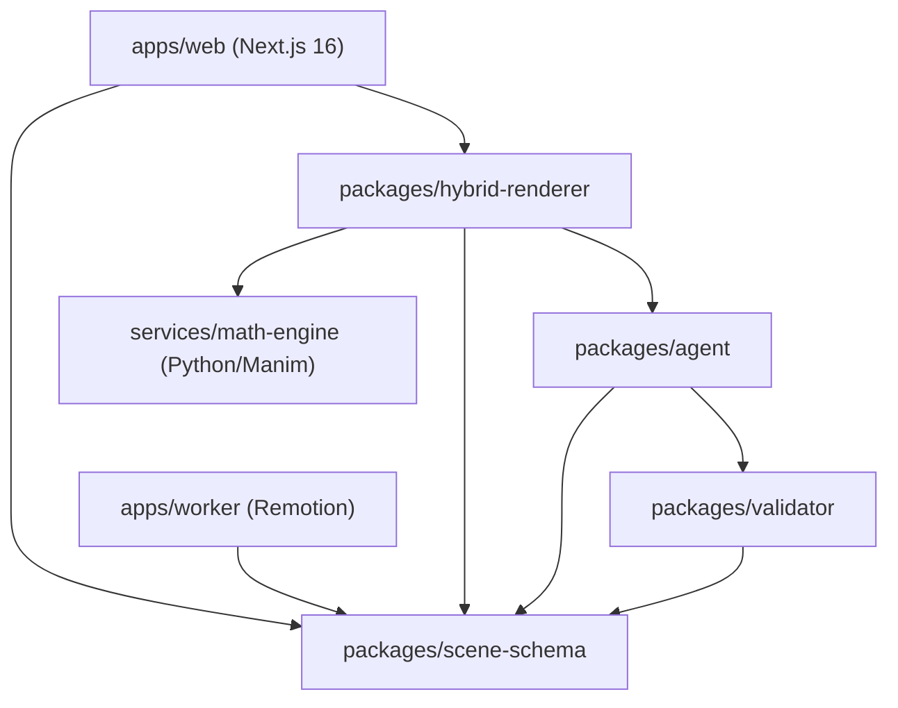

# LuminaLearn Architecture V2 — Audit & Code Review Report

**Repository**: `D:\Hackathon\LuminaLearn`  
**Ngày thực hiện**: 07/11/2026  
**Người thực hiện**: Principal Software Architect & AI Video Systems Designer  

---

## 1. Giới thiệu & Mục tiêu Audit

LuminaLearn đã hoàn tất thành công các giai đoạn từ Phase 1 đến Phase 5, xây dựng một pipeline hybrid hoàn chỉnh:
- **Phase 1**: Bootstrap Next.js 16, App Router, responsive STEM EdTech UI.
- **Phase 2**: Remotion video compositor, 4 template cơ bản, 720×1280 24fps.
- **Phase 3**: Gemini AI Lesson Planner, SymPy Math Validator, Zod structured output.
- **Phase 4**: Hybrid rendering kết hợp Manim Community (animation toán học chính xác) và Remotion.
- **Phase 5**: Hệ thống lồng tiếng (Voiceover), phụ đề phân đoạn (Burned-in & SRT), HTTP Range 206 video streaming, và Local Job Persistence có khả năng phục hồi sau sự cố.

Báo cáo audit này phân tích hiện trạng mã nguồn, chỉ ra các điểm thắt cổ chai và thiết kế lộ trình nâng cấp lên **Architecture V2**: Hỗ trợ đa chủ đề toán học, mở rộng animation DSL theo registry, và đặt nền móng xử lý tài liệu (Document-to-Video).

---

## 2. Sơ đồ phụ thuộc hiện tại (Current Dependency Graph)



### Đánh giá kiến trúc phân lớp:
1. **`packages/scene-schema`**: Đóng vai trò là Single Source of Truth cho toàn bộ dữ liệu (contract). Mọi package khác đều phụ thuộc vào nó.
2. **`packages/agent`**: Đảm nhiệm sinh kế hoạch bài học và kịch bản trực quan qua Gemini adapter.
3. **`packages/validator`**: Cung cấp logic kiểm chứng toán học (Simpson paradox baseline và SymPy bridge).
4. **`packages/hybrid-renderer`**: Bộ điều phối pipeline trên server (gọi Python Manim CLI, Remotion CLI, FFmpeg, TTS và quản trị job queue).
5. **`apps/web`**: Giao diện người dùng và API route handler.

---

## 3. Các hạn chế và điểm "khóa cứng" (Hardcoded Constraints) đã phát hiện

Qua rà soát trực tiếp mã nguồn, 7 vấn đề cốt lõi sau được xác nhận:

### 3.1. Schema bị khóa chặt vào bài toán Đạo hàm 40 giây
- `packages/scene-schema/src/math.schema.ts`:
  - `topicId: z.literal('calculus.derivative.intuition')` bị khóa cứng.
  - Hàm số bị giới hạn duy nhất ở `PolynomialFunctionSchema`.
  - Chỉ hỗ trợ 2 visualization: `function_graph` và `secant_to_tangent`.
- `packages/scene-schema/src/hybrid.schema.ts`:
  - `HYBRID_TOTAL_FRAMES = 960` (đúng 40 giây ở 24fps).
  - `timelineScenes: z.array(...).length(5)`: Bắt buộc đúng 5 scene với 5 template cố định (`hook`, `math_clip`, `equation_explanation`, `intuition_formula`, `summary`).
- `packages/hybrid-renderer/src/request.ts`:
  - Regex lọc chủ đề chỉ chấp nhận từ khóa về đạo hàm/tiếp tuyến/cát tuyến.
  - `durationSeconds: z.literal(40)` và `language: z.literal('vi')` bị khóa cứng.

### 3.2. Multi-Agent còn mang tính tuần tự đơn giản, thiếu Orchestration
- `packages/agent/src/planner.ts`:
  - `MathLessonPlanner` và `VisualStoryboardDirector` chỉ gọi Gemini tuần tự qua prompt text đơn giản.
  - Thiếu lớp điều phối (Orchestrator) có trạng thái rõ ràng, thiếu context chia sẻ, không có cơ chế retry có giới hạn (bounded retry) khi LLM sinh schema lỗi.

### 3.3. Narration Agent bị hardcode kịch bản lời thoại
- `packages/agent/src/narration.ts`:
  - Toàn bộ nội dung lời thoại tiếng Việt và gợi ý phát âm (`pronunciationHints`) của 5 phân đoạn được fix cứng trong mã nguồn (`narration_hook`, `narration_geometry`, `narration_equation`, `narration_formula`, `narration_summary`).
  - Chưa thể sinh lời dẫn động từ Lesson Plan và Storyboard của chủ đề bất kỳ.

### 3.4. Renderer Manim thiếu Registry mở rộng có kiểm soát
- `services/math-engine/src/luminalearn_math_engine/renderer.py`:
  - Chỉ dispatch cứng giữa `FunctionGraphScene` và `SecantToTangentScene`.
  - Chưa có cơ chế đăng ký (Template Registry) khai báo capabilities, schema tham số, độ phức tạp tính toán và validator tương ứng.
  - Nguy cơ nếu mở rộng sai cách: Để LLM sinh trực tiếp mã Python tùy ý sẽ dẫn đến lỗ hổng Remote Code Execution (RCE).

### 3.5. Chưa có nền móng tiếp nhận tài liệu (Document-to-Video)
- Chưa có cấu trúc phân tách giữa:
  - `evidence_found`: Mệnh đề/trích dẫn thực sự xuất hiện trong tài liệu (PDF/DOCX/Markdown).
  - `mathematically_verified`: Mệnh đề đã được kiểm chứng bằng công cụ hình thức (SymPy).
- Thiếu data model cho Document Chunks, Page References, và Grounding Verification.

### 3.6. TTS Provider và kiểm định thông tin xác thực
- `GoogleCloudTtsProvider` đã tồn tại trong `packages/hybrid-renderer/src/audio.ts`.
- Tuy nhiên, việc kiểm tra điều kiện kích hoạt cần chặt chẽ: Sự hiện diện của biến môi trường `GOOGLE_CLOUD_PROJECT` không đồng nghĩa với việc đã xác thực thành công (Application Default Credentials). Cần phân biệt rõ trạng thái cấu hình và trạng thái xác thực.

### 3.7. Pipeline phụ thuộc môi trường Windows
- `packages/hybrid-renderer/src/pipeline.ts`:
  - Hardcode đường dẫn Python venv: `services/math-engine/.venv/Scripts/python.exe`.
  - Hardcode đường dẫn Google Chrome: `C:\Program Files\Google\Chrome\Application\chrome.exe`.
  - Điều này ngăn cản việc đóng gói Docker container hoặc triển khai trên Linux server.

---

## 4. Phân tích rủi ro tương thích ngược (Breaking-Change Risks)

| Rủi ro | Mức độ ảnh hưởng | Giải pháp kiểm soát |
| :--- | :---: | :--- |
| Sửa trực tiếp `MathSceneSchema` hoặc `HybridVideoManifestSchema` | **NGUY HIỂM CAO** | Không sửa schema V1. Xây dựng không gian tên mới `packages/scene-schema/src/v2/`. Giữ nguyên 100% contracts cũ để video Phase 1-5 tiếp tục render bình thường. |
| Thay đổi `buildHybridManifest` | **NGUY HIỂM CAO** | Tạo `StoryboardCompilerV2` song song. Thêm adapter chuyển đổi nếu cần nối vào pipeline cũ. |
| Thay đổi giao diện `GeminiAdapter` | **TRUNG BÌNH** | Giữ nguyên interface `generateStructured`. Bổ sung orchestration layer bọc ngoài adapter. |
| Sửa `runHybridPipeline` phá vỡ web job runner | **NGUY HIỂM CAO** | Tách `EnvironmentConfig` và `ErrorTaxonomy` thành module độc lập, tiêm (inject) vào pipeline mà không đổi chữ ký hàm public. |

---

## 5. Các thành phần có thể tái sử dụng (Reusable Components)

1. **`MockGeminiAdapter` & `LiveGeminiAdapter`**: Tái sử dụng trọn vẹn cho tầng orchestration.
2. **`probeAndVerifyVideoAsset` & `probeFinalVideo` (FFprobe)**: Giữ nguyên logic kiểm định media nghiêm ngặt (fps, bitrate, frameCount, audio sync).
3. **`LocalJobRepository`**: Giữ nguyên cơ chế ghi nguyên tử (`writeAtomic`) và phục hồi job sau sự cố (`interrupted`).
4. **Remotion Composition Engine (`apps/worker`)**: Tái sử dụng các primitive animation, math clip player, subtitle overlay.
5. **Python SymPy Engine (`services/math-engine`)**: Tái sử dụng parser biểu thức an toàn (`safe_expression.py`) và validator đạo hàm.

---

## 6. Đề xuất ranh giới Module (Proposed Module Boundaries V2)

```
packages/scene-schema/src/v2/
├── contracts.ts          # LessonRequestV2, LessonPlanV2, VerifiedClaim, StoryboardV2, ManifestV2
├── template-registry.ts  # MathTemplateRegistry, MathTemplateDefinition
├── document.ts           # DocumentChunk, SourceReference, GroundingEvidence
└── storyboard-compiler.ts# Dynamic Storyboard Compiler

packages/agent/src/orchestration/
├── types.ts              # Agent roles, execution context, orchestration state
├── router.ts             # TopicRouter (phân loại chủ đề, template phù hợp)
├── document-analyst.ts   # DocumentAnalyst (trích xuất claims, grounding)
├── curriculum-planner.ts # CurriculumPlanner (sư phạm, phân cấp mục tiêu)
├── storyboard-director.ts# VisualStoryboardDirector (chọn template, gắn claim)
├── narration-planner.ts  # NarrationPlanner (sinh lời dẫn động, pronunciation hints)
├── quality-reviewer.ts   # QualityReviewer (kiểm định deterministic toàn diện)
└── orchestrator.ts       # LessonOrchestrator (State machine, bounded retries)

packages/hybrid-renderer/src/
├── config.ts             # EnvironmentConfig (Cross-platform paths, concurrency, defaults)
└── error-taxonomy.ts     # LuminaError & ErrorTaxonomy (Safe user messages, standard error codes)
```

---

## 7. Kế hoạch di trú (Migration Plan)

1. **Giai đoạn 1 (Milestone B & C)**: Thiết lập V2 Contracts và Multi-Agent Orchestrator trong các thư mục riêng biệt. Chạy song song bộ test của V1 và V2.
2. **Giai đoạn 2 (Milestone D & E)**: Thiết lập Math Template Registry và Document Grounding Foundation. Đăng ký 2 template hiện có (`function_graph`, `secant_to_tangent`) và định nghĩa mở rộng cho 3 template mới.
3. **Giai đoạn 3 (Milestone F & H)**: Tạo Dynamic Storyboard Compiler V2 và EnvironmentConfig cross-platform.
4. **Giai đoạn 4 (Regression & Verification)**: Chạy toàn bộ 56 Node tests, 11 Python tests, Typecheck monorepo và Next.js build. Đảm bảo zero regression trên pipeline Phase 1-5 hiện tại.

