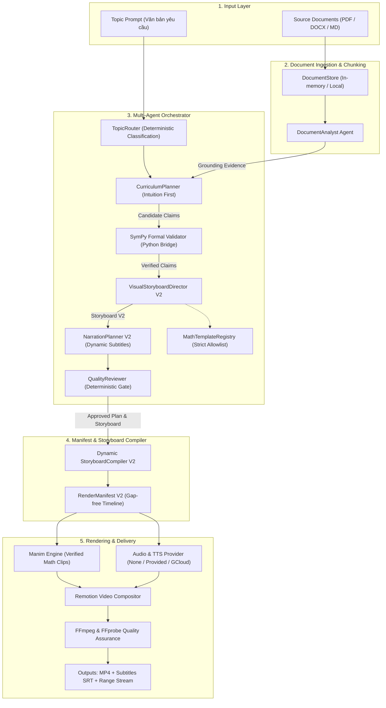
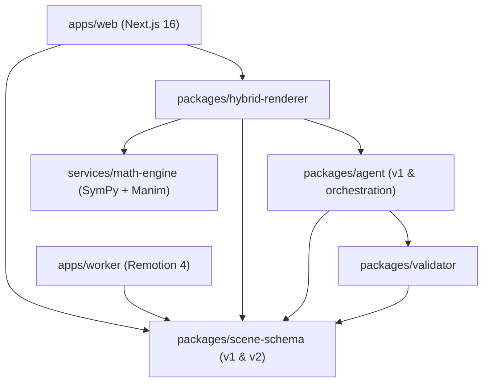
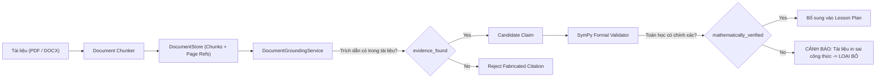

# LuminaLearn Architecture V2: Technical Specification

**Dự án**: LuminaLearn — Nền tảng AI tạo video bài giảng Toán học trực quan  
**Phiên bản**: Architecture V2 (Multi-Agent Orchestration, Extensible Math Scene DSL & Document-to-Video Foundation)  
**Ngày phát hành**: 07/11/2026  
**Trạng thái**: Hoàn thành triển khai Milestone cốt lõi (100% Typecheck & 82 Node Tests + 11 Python Tests Passed)  

---

## 1. Mục tiêu và Tầm nhìn Architecture V2

LuminaLearn V1 (Phase 1–5) đã chứng minh tính khả thi của pipeline hybrid: Gemini AI lập kế hoạch bài học, SymPy kiểm định tính đúng đắn, Manim dựng animation chuyển động toán học chính xác và Remotion tổng hợp video 40 giây kèm phụ đề và giọng đọc.

Tuy nhiên, V1 tồn tại các hạn chế cấu trúc:
1. **Khóa cứng vào bài đạo hàm**: Schema, renderer, duration (960 frames) và 5 scene bị fix cứng trong code.
2. **Multi-Agent tuần tự đơn giản**: Thiếu orchestration state machine, context chia sẻ và bounded retries.
3. **Lời thoại hardcode**: Narration chưa sinh động theo kế hoạch bài học.
4. **Renderer thiếu Registry**: Manim chỉ dispatch thủ công giữa 2 cảnh, có rủi ro nếu cho LLM sinh mã tùy tiện.
5. **Chưa có nền tảng tiếp nhận tài liệu**: Thiếu mô hình dữ liệu cho Document Chunks, Page References và Grounding Evidence.
6. **Phụ thuộc Windows**: Hardcode đường dẫn Python venv và Chrome binary.

**Architecture V2 giải quyết triệt để các hạn chế trên**, xây dựng một nền tảng:
- Hỗ trợ đa chủ đề toán học thông qua **Topic Registry** và **Math Template Registry**.
- Hỗ trợ tài liệu đầu vào (PDF/DOCX/Markdown) thông qua **Document Grounding Foundation**.
- Đảm bảo **Zero Arbitrary Code Execution**: AI chỉ trao đổi dữ liệu có cấu trúc (Strict Zod Schemas), không sinh code Python/JS chạy trực tiếp.
- Giữ vững nguyên tắc **Fail-Closed Mathematical Validation**: Mệnh đề sai toán học sẽ bị chặn ngay tại validation gate, tuyệt đối không dạy kiến thức sai lệch dù tài liệu có in nhầm.
- **Tương thích ngược 100%**: Toàn bộ đường chạy Phase 1–5 tiếp tục hoạt động nguyên vẹn.

---

## 2. Sơ đồ Kiến trúc Tổng thể (High-Level Architecture)



---

## 3. Package Dependency Graph (Sơ đồ phụ thuộc Monorepo)



---

## 4. Ma trận Trách nhiệm của các AI Agents (Agent Responsibility Matrix)

| Agent / Module | Input | Output | Trách nhiệm chính & Ràng buộc an toàn |
| :--- | :--- | :--- | :--- |
| **`TopicRouter`** | `LessonRequestV2` | `TopicClassification` | Phân loại chủ đề theo danh mục giáo trình (`calculus`, `linear_algebra`, `trigonometry`, `statistics`). Nếu không thuộc danh mục, trả về `unsupported_topic`, tuyệt đối không tự ý thay thế chủ đề khác. |
| **`DocumentAnalyst`** | Document Chunks + Page Refs | `DocumentAnalysisResult` | Trích xuất khái niệm cốt lõi, candidate claims và đối chiếu trích dẫn nguyên văn trong tài liệu qua `DocumentGroundingService`. Coi tài liệu là dữ liệu không tin cậy (untrusted data). |
| **`CurriculumPlanner`** | `TopicClassification` + Evidence | `LessonPlanV2` | Thiết kế bài giảng theo nguyên lý "Trực giác trước, công thức sau". Lập trình tự sư phạm (`pedagogicalSequence`), mục tiêu học tập và danh mục mệnh đề toán học cần kiểm định. |
| **`VisualStoryboardDirectorV2`** | `LessonPlanV2` + `MathTemplateRegistry` | `StoryboardV2` | Lựa chọn visual template từ Registry, gán tham số hoạt họa, phân bổ khung hình (duration frames) và liên kết claim IDs với các phân cảnh trực quan. Không sinh mã Python thô. |
| **`NarrationPlannerV2`** | `LessonPlanV2` + `StoryboardV2` | `NarrationPlanV2` | Sinh lời dẫn tiếng Việt tự nhiên theo phân đoạn, giới hạn tốc độ nói (2.8 - 3.2 từ/giây), cung cấp gợi ý phát âm (`pronunciationHints`) cho công thức toán học và định dạng phụ đề. |
| **`QualityReviewer`** | `OrchestrationContext` | `QualityReviewResult` | Cổng kiểm định tất định (Deterministic Validation Gate): Kiểm tra tính xác thực của SymPy, template hợp lệ trong Registry, timeline không hở, độ phủ lời dẫn và trích dẫn nguồn. |
| **`LessonOrchestrator`** | `LessonRequestV2` (raw) | `OrchestrationContext` | Máy trạng thái điều phối toàn bộ vòng đời bài học qua 9 giai đoạn, ghi log chi tiết, xử lý bounded retries (tối đa 2 lần) và fail-closed khi gặp lỗi toán học. |

---

## 5. Domain Data Contracts V2 (Strict Zod Schemas)

Tất cả các contracts V2 được đặt tại `packages/scene-schema/src/v2/` và áp dụng `.strict()`, ngăn chặn mọi trường lạ hoặc mã thực thi:

### 5.1. `LessonRequestV2`
```typescript
interface LessonRequestV2 {
  requestId: string;
  inputMode: 'topic_prompt' | 'source_document';
  topic: string;
  sourceDocumentIds: string[];
  audience: string;
  language: 'vi' | 'en';
  targetDurationSeconds: number; // 20 đến 300s
  renderMode: 'mock' | 'live';
  narrationMode: 'none' | 'provided_audio' | 'google_cloud_tts';
  aspectRatio: '9:16' | '16:9' | '1:1';
  providedAudioPath?: string;
}
```

### 5.2. `LessonPlanV2` & `VerifiedClaim`
```typescript
interface VerifiedClaim {
  id: string;
  statement: string;
  validatorKey: string;
  expectedExpression: string; // Regex: chỉ cho phép ký tự toán học an toàn
  verificationStatus: 'verified' | 'unverified' | 'failed';
  sourceReferenceId?: string;
}

interface LessonPlanV2 {
  schemaVersion: 'lesson-v2';
  lessonId: string;
  topicId: string;
  title: string;
  learningObjectives: string[];
  prerequisites: string[];
  keyConcepts: string[];
  mathematicalClaims: VerifiedClaim[];
  sourceEvidence: GroundingEvidence[];
  pedagogicalSequence: PedagogicalStep[];
  summary: string;
}
```

### 5.3. `StoryboardV2` & `VisualSceneSpecV2`
```typescript
interface VisualSceneSpecV2 {
  sceneId: string;
  templateId: string;
  sceneType: 'intro' | 'concept' | 'animation' | 'formula' | 'summary';
  durationFrames: number;
  parameters: Record<string, unknown>; // Được validate bởi template parameterSchema
  layout: { aspectRatio: '9:16' | '16:9' | '1:1'; safeAreaPadding: number };
  mathematicalBinding: { boundClaimIds: string[]; latexFormulas: string[] };
  sourceReferenceIds: string[];
}
```

### 5.4. `RenderManifestV2`
```typescript
interface RenderManifestV2 {
  schemaVersion: 'manifest-v2';
  manifestId: string;
  jobId: string;
  topicId: string;
  lessonTitle: string;
  language: 'vi' | 'en';
  aspectRatio: '9:16' | '16:9' | '1:1';
  dimensions: { width: number; height: number };
  fps: number;
  totalFrames: number;
  timeline: TimelineSceneV2[]; // Gap-free contiguous timeline
  visualAssets: VisualAssetDescriptor[];
  audioAssets: AudioAssetDescriptor[];
  subtitleTrack?: SubtitleTrackDescriptor;
  verifiedClaims: VerifiedClaim[];
  sourceReferences: SourceReference[];
}
```

---

## 6. Math Template Registry (Visual DSL Mở Rộng)

Để mở rộng các visual animation toán học mà không cho phép AI sinh mã Python tự do, LuminaLearn triển khai `MathTemplateRegistry`:

### Danh mục Template đã đăng ký:
1. **`function_graph`** (Manim): Vẽ đồ thị hàm số và điểm khảo sát trên hệ trục tọa độ 2D.
2. **`secant_to_tangent`** (Manim): Mô phỏng điểm $Q$ trượt về $P$, đường cát tuyến dần xoay thành đường tiếp tuyến khi $h \to 0$.
3. **`riemann_sum`** (Manim - Extensible): Chia nhỏ diện tích hình phẳng dưới đường cong thành các dải chữ nhật xấp xỉ tích phân.
4. **`vector_transform`** (Manim - Extensible): Minh họa phép biến đổi tuyến tính ma trận $2 \times 2$ tác động lên các vector cơ sở $\hat{i}, \hat{j}$.
5. **`unit_circle`** (Hybrid - Extensible): Minh họa góc quay $\theta$ và các giá trị hàm lượng giác $\sin, \cos, \tan$ trên đường tròn đơn vị.

### Cơ chế bảo vệ:
- Mỗi template có `parameterSchema` riêng biệt với Zod validation.
- Tham số hoạt họa phải tuân thủ giới hạn toán học (ví dụ: $h_{end} < h_{start}$ và $h \neq 0$).
- Tách rời hoàn toàn giữa việc lựa chọn template (`VisualStoryboardDirectorV2`) và việc render Manim (`services/math-engine`).

---

## 7. Document-to-Video Foundation (Nền tảng Xử lý Tài liệu)

LuminaLearn V2 đặt nền móng tiếp nhận tài liệu học tập với nguyên tắc cốt lõi:



> [!CAUTION]
> **Quy tắc phân biệt nghiêm ngặt**:
> - `evidence_found = true`: Xác nhận câu trích dẫn thực sự xuất hiện trong tài liệu tại trang chỉ định.
> - `mathematically_verified`: CHỈ được cấp khi công cụ toán hình thức (SymPy) chứng minh tính đúng đắn.
> - **Ví dụ thực tế**: Nếu một tài liệu in nhầm $f'(x) = 3x$ cho $f(x) = x^2$, hệ thống sẽ ghi nhận `evidenceFound: true` nhưng SymPy sẽ đánh dấu `verificationStatus: 'failed'`. Bài giảng sẽ **từ chối sử dụng công thức sai này**, bảo vệ người học khỏi kiến thức sai lệch.

---

## 8. Dynamic Storyboard Compiler V2

`compileStoryboardV2` đảm nhận việc chuyển đổi linh hoạt:
- **Timeline liên tục, không khe hở (Gap-free)**: Duyệt tuần tự qua danh sách scene, tính toán chính xác `startFrame` và `durationFrames` nối tiếp nhau.
- **Không giới hạn 5 scene**: Cho phép cấu trúc bài học có từ 2 đến 12 phân cảnh tùy độ phức tạp của chủ đề.
- **Hỗ trợ đa tỷ lệ khung hình**:
  - `9:16`: $720 \times 1280$ (Dọc di động: Shorts, TikTok, Reels).
  - `16:9`: $1280 \times 720$ (Ngang truyền thống: Desktop, YouTube).
  - `1:1`: $1080 \times 1080$ (Vuông: Bảng tin trực tuyến).
- **Đồng bộ phụ đề tự động**: Tạo các cue phụ đề khớp hoàn toàn với thời điểm bắt đầu và kết thúc của từng phân cảnh.

---

## 9. Environment & Error Taxonomy

Module `packages/hybrid-renderer/src/config.ts` và `error-taxonomy.ts`:
- **`EnvironmentConfig`**: Tự động nhận diện hệ điều hành (Windows vs Linux/Docker), tìm kiếm binary thực thi theo thứ tự ưu tiên: Biến môi trường $\to$ Đường dẫn hệ thống $\to$ Fallback mặc định.
- **`LuminaError` & Phân loại lỗi chuẩn hóa**:
  - `unsupported_topic` (HTTP 400)
  - `invalid_document` (HTTP 400)
  - `extraction_failed` (HTTP 422)
  - `unsupported_visualization` (HTTP 400)
  - `mathematical_verification_failed` (HTTP 422)
  - `source_evidence_missing` (HTTP 400)
  - `narration_invalid` (HTTP 400)
  - `tts_unavailable` (HTTP 503)
  - `render_failed` (HTTP 500)
  - `asset_validation_failed` (HTTP 500)
- **An toàn người dùng**: API chỉ trả về mã lỗi và thông báo thân thiện bằng tiếng Việt, tuyệt đối không làm lộ stack trace, đường dẫn máy chủ hoặc khóa bí mật.

---

## 10. Chiến lược Di trú & Bảo tồn Pipeline Phase 1–5 (Migration Strategy)

1. **Không sửa đổi breaking changes trên V1**:
   - `MathSceneSchema` và `HybridVideoManifestSchema` V1 được giữ nguyên vẹn.
   - Các API `/api/jobs` và renderer Phase 4-5 tiếp tục sử dụng V1 cho video đạo hàm và Simpson paradox hiện tại.
2. **Không gian tên V2 độc lập**:
   - `packages/scene-schema/src/v2/` và `packages/agent/src/orchestration/` cung cấp contract và orchestrator thế hệ mới.
3. **Mở rộng tương thích**:
   - `packages/scene-schema/src/index.ts` re-export cả V1 và V2.
   - `packages/agent/src/index.ts` re-export cả planner cũ và multi-agent orchestrator mới.
   - `packages/hybrid-renderer/src/pipeline.ts` sử dụng `loadEnvironmentConfig` cross-platform nhưng giữ nguyên 100% logic render hiện hữu.

---

## 11. Kế hoạch Tiếp theo (Follow-Up Roadmap)

- [ ] **Giai đoạn 1**: Xây dựng UI Upload PDF/DOCX trên `apps/web` và kết nối thư viện `pdf-parse` / `mammoth`.
- [ ] **Giai đoạn 2**: Kết nối Live Gemini 2.5 Flash vào `DocumentAnalyst` để trích xuất ngữ nghĩa tự động từ sách giáo trình.
- [ ] **Giai đoạn 3**: Hoàn thiện kịch bản Manim cho template `riemann_sum` và `vector_transform` trong `services/math-engine`.
- [ ] **Giai đoạn 4**: Tích hợp Google Cloud ADC live credentials để kiểm định giọng đọc TTS tự động đa ngôn ngữ.
- [ ] **Giai đoạn 5**: Triển khai Docker container hóa cho toàn bộ monorepo trên nền Linux.

