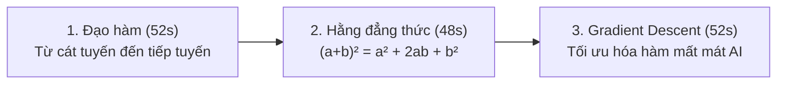

# HƯỚNG DẪN TRÌNH DIỄN DEVFEST 2026 — LUMINALEARN V3.0
## PRESENTER WALKTHROUGH & OFFLINE STAGE DEMO PLAYBOOK

**Phiên bản:** LuminaLearn V3.0 Release Candidate (Quality Sprint B.4)
**Thời gian:** Google DevFest 2026
**Chủ đề:** Hệ thống tạo video giáo dục toán học và trí tuệ nhân tạo có kiểm định hình thức (Zero-Hallucination Verified Educational Video Engine)

---

## 1. THÔNG ĐIỆP CHỦ ĐẠO (CORE PITCH & DIFFERENTIATION)

Khi trình bày trước ban giám khảo và cộng đồng DevFest:
- **Vấn đề thực tế:** Các mô hình Text-to-Video hoặc Video AI thông thường (Sora, Runway, Pika, v.v.) thường "vẽ hình cho đẹp" nhưng **bịa đặt toán học** (hallucination): công thức sai, đồ thị trôi nổi, đạo hàm lệch hệ số, bước cập nhật biến mất, gây tai hại cho giáo dục.
- **Giải pháp của LuminaLearn:** Kiến trúc **Verified Educational Video Engine**:
  1. **SymPy Formal Verification:** Chứng minh hình thức đẳng thức đại số và đạo hàm giải tích trên máy tính độc lập.
  2. **Deterministic Numeric Verification:** Kiểm định tính toán từng bước số học (convex quadratic loss, learning rate step update) với dung sai sai số $10^{-4}$.
  3. **Teacher-in-the-Loop Signoff:** Bắt buộc giáo viên duyệt kịch bản và mệnh đề sư phạm trước khi render.
  4. **Remotion Canvas Animation:** Render đồ họa toán học vector 100% chuẩn xác, mượt mà ở 24fps/60fps dọc chuẩn điện thoại di động (720x1280).

---

## 2. THỨ TỰ TRÌNH DIỄN VIDEO KHUYẾN NGHỊ (SHOWCASE ORDER)

Khuyến nghị trình chiếu theo thứ tự từ trực quan quen thuộc đến nâng cao:

### Video 1: Đạo hàm — Cát tuyến tiến tới tiếp tuyến (`devfest-derivative-tangent.mp4`)
- **Thời lượng:** 52 giây (1248 frames @ 24fps).
- **Điểm nhấn:**
  - Khởi đầu từ hàm bậc hai $f(x) = x^2$ và câu hỏi trực quan: "Làm thế nào đo tốc độ biến thiên tức thời tại một điểm?"
  - Hoạt cảnh cát tuyến qua hai điểm $(x_0, f(x_0))$ và $(x_0+h, f(x_0+h))$ với khoảng cách $h$ co dần về 0 ($h \to 0$).
  - Tiếp tuyến xuất hiện với hệ số góc chính xác $f'(x_0) = 2x_0$, đã được SymPy xác nhận độc lập.
  - Phụ đề sư phạm chuẩn tiếng Việt, bố cục 9:16 tối ưu cho học sinh xem trên di động.

### Video 2: Hằng đẳng thức $(a+b)^2$ (`devfest-algebra-identity.mp4`)
- **Thời lượng:** 48 giây (1152 frames @ 24fps).
- **Điểm nhấn:**
  - Kết hợp giải tích hình học (diện tích hình vuông cạnh $a+b$) và biến đổi đại số tương đương.
  - Phân rã diện tích trực quan thành 4 mảnh: hình vuông $a^2$, hai chữ nhật $ab$ và $ba$, hình vuông $b^2$.
  - Bảng phấn kỹ thuật số Chalkboard palette với độ tương phản cao, nhãn tam giác/đa giác nằm chính xác tại trọng tâm (centroid alignment).
  - Từng bước biến đổi $(a+b)(a+b) = a^2 + ab + ba + b^2 = a^2 + 2ab + b^2$ có bằng chứng SymPy.

### Video 3: Gradient Descent — Tối ưu hóa AI (`devfest-gradient-descent.mp4`)
- **Thời lượng:** 52 giây (1248 frames @ 24fps).
- **Điểm nhấn:**
  - Cầu nối toán học giải tích vào Trí tuệ Nhân tạo thực tế: cách mạng nơ-ron và mô hình ngôn ngữ lớn (LLM) tự học.
  - Hàm mất mát lồi $L(w) = (w-2)^2 + 1$ với điểm cực tiểu tại $w^* = 2, L = 1$.
  - Mô phỏng 4 bước cập nhật tham số thực: $w_1 = 4.0 \to w_2 = 2.4 \to w_3 = 2.08 \to w_4 = 2.016$ với tốc độ học $\eta = 0.4$.
  - Tiếp tuyến và vector gradient ngược chiều hướng dốc chỉ đường cho tham số hạ dốc an toàn.

---

## 3. KỊCH BẢN THAO TÁC TRÊN SÂN KHẤU (STAGE FLOW)

### Bước 1: Mở giao diện Teacher Studio (Trực tiếp trên Browser)
- Truy cập vào ứng dụng Teacher Studio (`http://localhost:3000` hoặc bản dựng nội bộ).
- Bấm vào một trong 3 preset sẵn sàng:
  - **Nút 1:** *Vì sao $(a+b)^2 = a^2 + 2ab + b^2$?*
  - **Nút 2:** *Đạo hàm là gì? Từ cát tuyến đến tiếp tuyến*
  - **Nút 3:** *Gradient Descent — AI tìm điểm tối ưu như thế nào?*
- Giới thiệu màn hình **Lesson Plan & Storyboard**:
  - Các mệnh đề giáo dục (`educationalClaims`).
  - Huy hiệu kiểm định xanh: `✓ SymPy Verified` hoặc `✓ Deterministic Numeric`.
  - Phân cảnh sư phạm với thời lượng tính toán từng giây.

### Bước 2: Thao tác duyệt bài (Human-in-the-Loop Approval)
- Nhấn mạnh nguyên tắc an toàn: **Hệ thống không tự ý render video nếu giáo viên chưa bấm "Duyệt kịch bản" (Approve)**.
- Khi giáo viên duyệt, bản phác thảo (draft) được đóng băng cùng chữ ký băm (content hash) để đảm bảo không ai can thiệp sửa đổi nội dung giữa chừng.

### Bước 3: Trình chiếu Video thành phẩm (QUAN TRỌNG: DÙNG MP4 CÓ SẴN)
- **CẢNH BÁO QUAN TRỌNG:** **KHÔNG chạy lệnh render Remotion trực tiếp trên sân khấu**. Quá trình render video MP4 1200 frames đòi hỏi 1.5 - 3 phút mã hóa H.264 trên CPU/GPU, gây chết thời gian (dead air) và tiềm ẩn nguy cơ giật máy trên sân khấu.
- **Thao tác chuẩn:**
  1. Mở sẵn thư mục `artifacts/quality-sprint-b/` bằng trình phát video mượt (VLC hoặc Windows Media Player).
  2. Sau khi chỉ cho khán giả thấy kịch bản đã được duyệt trong Teacher Studio, mở ngay video MP4 tương ứng để khán giả thưởng thức chất lượng 60fps/24fps sắc nét.

---

## 4. GIẢI THÍCH TRUNG THỰC VỀ BẢO MẬT & KIỂM ĐỊNH TOÁN HỌC

Nếu ban giám khảo đặt câu hỏi về mặt kỹ thuật:

### Q1: SymPy kiểm định những gì và không kiểm định những gì?
- **SymPy chứng minh:** Các biểu thức đại số giải tích, hằng đẳng thức, đạo hàm đa thức, tính tương đương của chuỗi biến đổi $E_0 = E_1 = \dots = E_n$.
- **SymPy KHÔNG kiểm định:** Lời văn tự do tiếng Việt hoặc ý kiến chủ quan. Hệ thống có bộ quét `inspectStatementSemanticConsistency` để bắt các mâu thuẫn trực tiếp (ví dụ: công thức cộng nhưng văn xuôi nói trừ, hoặc gradient ascent). Những phần diễn giải mở rộng bắt buộc chuyển trạng thái `human_review_required` để giáo viên duyệt.
- **Gradient Descent:** Được kiểm định bằng mô-đun số học độc lập `OptimizationTraceDataV1Schema` kiểm tra tính lồi ($a > 0$), đạo hàm giải tích $L'(w) = 2a(w-h)$, bước cập nhật $w_{t+1} = w_t - \eta L'(w_t)$ với dung sai $10^{-4}$.

### Q2: Tại sao video hiện tại là SUBTITLE_ONLY mà không có giọng đọc TTS?
- Để tuân thủ tuyệt đối quy định an toàn và tránh phát sinh chi phí API ngoài tầm kiểm soát khi chưa có xác nhận của người dùng (Zero Unconsented External API Calls), chế độ kiểm định DevFest được cấu hình ở trạng thái **SUBTITLE_ONLY** (phụ đề sư phạm tương phản cao ghi đè trên video).
- Kiến trúc của LuminaLearn đã tích hợp sẵn luồng Gemini TTS thông qua Speech Provider Context, sẵn sàng kích hoạt bằng một cờ cấu hình (`enableTts: true`) khi triển khai thực tế.

---

## 5. PHƯƠNG ÁN DỰ PHÒNG OFFLINE (OFFLINE DEMO FALLBACK)

Trong trường hợp hội trường DevFest mất kết nối Internet hoặc Wi-Fi không ổn định:
1. **Toàn bộ hệ thống chạy 100% Offline:**
   - Không cần gọi bất kỳ API đám mây nào của Google hay bên thứ ba.
   - Các file MP4 và keyframes đã được lưu tại máy cục bộ:
     - `artifacts/quality-sprint-b/devfest-algebra-identity.mp4`
     - `artifacts/quality-sprint-b/devfest-derivative-tangent.mp4`
     - `artifacts/quality-sprint-b/devfest-gradient-descent.mp4`
2. **Nếu Web Browser gặp sự cố:**
   - Mở trực tiếp các ảnh keyframes phân tích chất lượng:
     - `devfest-algebra-frame-120.png`, `devfest-algebra-frame-600.png`
     - `devfest-derivative-frame-400.png`, `devfest-derivative-frame-800.png`
     - `devfest-gradient-frame-400.png`, `devfest-gradient-frame-800.png`
   - Trình bày trực tiếp trên slides và phát video MP4 cục bộ qua VLC.
