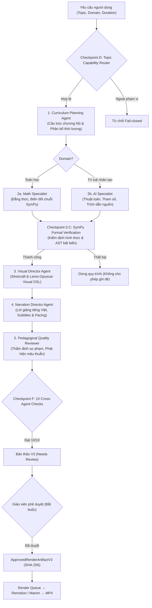

# BÁO CÁO KỸ THUẬT LUMINALEARN V3.0 — PHASE 5
# MULTI-AGENT EDUCATIONAL SUPERVISOR
# VERIFIED MATHEMATICS & AI VIDEO ORCHESTRATION

**Dự án:** LuminaLearn  
**Repository:** `D:\Hackathon\LuminaLearn` (GitHub: `nhukhoalofi/LuminaLearn`)  
**Nhánh làm việc (Target Branch):** `feat/v3-phase5-educational-supervisor`  
**Reviewed Baseline Commit:** `5f1778c83d70b121a02e0acf56f13392a6a40069` (`fix: complete V3 Phase 4.1.1 final integrity closure and regression hardening`)  
**Thời điểm hoàn thành:** 09/11/2026  
**Trạng thái nghiệm thu:** HOÀN THÀNH TOÀN DIỆN (CHECKPOINTS 0 → M) — **QUYẾT NGHỊ: GO**

---

## 1. TỔNG QUAN KIẾN TRÚC MULTI-AGENT SUPERVISOR (PHASE 5)

LuminaLearn là nền tảng AI tạo video bài giảng sư phạm chuyên sâu cho **hai lĩnh vực duy nhất**:
1. **Toán học (Mathematics)**
2. **Trí tuệ nhân tạo & Học máy (Artificial Intelligence / Machine Learning)**

Phase 5 hiện thực hóa dịch vụ điều phối trung tâm cấp cao: **`EducationalSupervisorV3`** (`packages/agent/src/orchestration/educational-supervisor-v3.ts`). Hệ thống kết nối và điều phối **6 vai trò Agent chuyên trách** với các hợp đồng dữ liệu Zod kiểu tĩnh nghiêm ngặt (`packages/scene-schema/src/v3/supervisor.ts`), loại bỏ hoàn toàn các thông điệp phi cấu trúc và ngăn chặn rủi ro tự sinh mã tùy tiện.

---

## 2. KẾT QUẢ TRIỂN KHAI CHI TIẾT CÁC CHECKPOINT

### CHECKPOINT 0 — BẢO MẬT & TOÀN VẸN TRI THỨC (MANDATORY P0 GATE)
1. **Gia cố cơ chế ký Consent (Checkpoint 0.A):**
   - Loại bỏ hoàn toàn `Math.random()` trong việc sinh `consentId`; chuyển sang sử dụng `crypto.getRandomValues(new Uint8Array(12))` tạo ID ngẫu nhiên an toàn mã hóa.
   - Thêm hàm so sánh chữ ký HMAC-SHA256 bất biến theo thời gian (`constantTimeEqual`) ngăn chặn tấn công timing attack.
   - Bắt buộc cấu hình biến môi trường server secret (`LUMINA_CONSENT_SIGNING_KEY` hoặc `CONSENT_SIGNING_SECRET`) đối với mọi yêu cầu live ngoài môi trường test.
   - Xóa bỏ triệt để các lỗ hổng bypass bằng cờ boolean (`externalApiConsent === true` hoặc `confirmExternalApi === true`) trong `pipeline-v3.ts` và `educational-planner-v3.ts`; bắt buộc phải có `consentRecord` hợp lệ được ký số và ràng buộc chính xác với `artifactId` và `contentHash`.
2. **Chuẩn hóa mô hình Gemini TTS (Checkpoint 0.B):**
   - Loại bỏ việc fallback âm thầm từ Gemini 3.8 sang `gemini-2.0-flash`.
   - Danh sách mô hình TTS hỗ trợ được thu hẹp về các mô hình TTS chuẩn: `gemini-3.8-flash-tts`, `gemini-3.8-flash-lite-tts`, `gemini-3.1-flash-tts-preview`, `gemini-2.5-flash-preview-tts`, `gemini-2.5-pro-preview-tts`.
   - Khi gặp lỗi 404/not_found, hệ thống trả về mã lỗi rõ ràng `tts_model_unavailable` và giữ nguyên chế độ kết xuất video im tiếng có phụ đề mà không phát sinh thêm cuộc gọi ngoài ngân sách.
3. **Toàn vẹn toán học & Hằng đẳng thức (Checkpoint 0.C):**
   - Bổ sung bảng định nghĩa chuẩn tắc `CANONICAL_ALGEBRA_IDENTITIES` đối soát `identityId` với vế trái và vế phải toán học.
   - Phát hiện và từ chối ngay lập tức nếu nhãn tiêu đề hoặc lời dẫn phân cảnh mâu thuẫn với bản chất hằng đẳng thức (ví dụ: `square_difference` nhưng tiêu đề lại ghi "Bình phương một tổng").
   - Đảm bảo trong hàm `approve()`, artifact xuất xưởng luôn chứa báo cáo kiểm định và danh sách mệnh đề mới nhất từ engine SymPy (`latestPlan`), ngăn chặn việc dùng lại báo cáo cũ.
   - Tuyệt đối không cho phép sự phê duyệt của con người ghi đè một chứng minh toán học hình thức đã thất bại.

---

### CHECKPOINT A, B, C — MULTI-AGENT ARCHITECTURE & TYPED CONTRACTS
Hiện thực hóa 6 vai trò Agent chuyên trách trong [`educational-supervisor-v3.ts`](file:///d:/Hackathon/LuminaLearn/packages/agent/src/orchestration/educational-supervisor-v3.ts):
1. **CurriculumPlanningAgent:** Phân tích yêu cầu, xác định đối tượng học viên (`TargetAudience`), xây dựng cấu trúc chương hồi (`EducationalChapterPlanV3`) và phân bổ thời lượng hợp lý.
2. **SubjectMatterSpecialist:**
   - **MathSpecialist:** Chuyên trách công thức, chuỗi biến đổi hình thức và ràng buộc kiểm định SymPy.
   - **AiSpecialist:** Chuyên trách thuật toán học máy, ví dụ số học (Perceptron forward pass, Gradient Descent update step, Self-Attention softmax weights) và đối soát tài liệu nguồn.
3. **VisualDirectorAgent:** Tiếp thu nguyên lý từ *Video Shotcraft* & *Lemo-Opuscar* (Treatment -> Shot Plan -> Visual DSL). Chọn lựa các component Remotion chuyên dụng (`AlgebraIdentityScene`, `NeuralArchitectureScene`, `LossLandscapeScene`, `AttentionHeatmapScene`). Tuyệt đối không thay đổi biểu thức toán đã chứng minh.
4. **NarrationDirectorAgent:** Biên soạn lời bình tiếng Việt sư phạm chuẩn, đồng bộ phụ đề, tính toán tốc độ phát âm (~14 ký tự/giây) và tự động tinh chỉnh văn phong nếu lời giảng vượt quá thời lượng cảnh.
5. **PedagogicalQualityReviewer:** Vai trò cố vấn sư phạm độc lập, chấm điểm độ rõ ràng (1-10), phát hiện mâu thuẫn ngữ nghĩa giữa lời giảng và công thức.
6. **EducationalSupervisorV3:** Điều phối toàn bộ đồ thị thực thi, kiểm soát ngân sách cuộc gọi (`GeminiRequestBudget`), thực hiện bounded retries (tối đa 2 lần/task), lưu vết `SupervisorTraceV3` và lắp ráp bản thảo V3.

Các schema Zod định kiểu được ban hành tại [`packages/scene-schema/src/v3/supervisor.ts`](file:///d:/Hackathon/LuminaLearn/packages/scene-schema/src/v3/supervisor.ts):
- `SupervisorRequestV3Schema`
- `AgentTaskV3Schema`
- `EducationalChapterPlanV3Schema`
- `VisualDirectionDecisionV3Schema`
- `NarrationDirectionResultV3Schema`
- `QualityReviewResultV3Schema`
- `SupervisorTraceV3Schema`
- `SupervisorFinalDraftV3Schema`

---

### CHECKPOINT D — ĐIỀU HƯỚNG THEO MA TRẬN NĂNG LỰC (CAPABILITY ROUTING)
Hệ thống phân định rạch ròi giữa 3 trạng thái năng lực:
1. **Hỗ trợ & Sẵn sàng kết xuất (Render-Ready):**
   - *Toán học:* 7 hằng đẳng thức đáng nhớ (`algebra.identities.seven`), Đạo hàm trực quan (`calculus.derivative.intuition`), Tích phân Riemann (`calculus.riemann_integral.intuition`).
   - *Trí tuệ nhân tạo:* Perceptron (`ai.perceptron.activation`), Gradient Descent (`ai.gradient_descent.optimization`), Self-Attention (`ai.transformer.attention`).
2. **Hỗ trợ ở mức lập kế hoạch (Planning-Only):**
   - Định lý Bayes, Lan truyền ngược (Backpropagation), Không gian Vector Embeddings, Giới hạn $\epsilon$-$\delta$, Biến đổi ma trận không gian.
3. **Ngoài phạm vi (Unsupported / Out-of-Scope):**
   - Vật lý, hóa học, sinh học, địa lý, nấu ăn, chứng khoán... Bị từ chối ngay lập tức ở cấp router với mã lỗi `DomainScopeViolationError`.

---

### CHECKPOINT F — KIỂM CHỨNG LIÊN AGENT (10 CONSISTENCY CHECKS)
Trước khi bàn giao bản thảo cho giáo viên, hàm `validateCrossAgentConsistency` thẩm định bắt buộc 10 tiêu chí:
1. Chủ đề bài học khớp với lĩnh vực khai báo (`mathematics` hoặc `artificial_intelligence`).
2. Mục tiêu học tập phản ánh đúng nội dung các cảnh.
3. Tổng thời lượng các cảnh khớp với thời lượng tổng thể bài học.
4. Lời dẫn thuyết minh tiếng Việt đầy đủ và giải thích đúng trọng tâm cảnh.
5. Nội dung phụ đề tiếng Việt đồng bộ và nhất quán với lời dẫn.
6. Mọi mệnh đề toán học hình thức đều có bằng chứng SymPy xác thực.
7. Toàn bộ các bước biến đổi đại số tương đương về mặt ký hiệu.
8. Các mệnh đề AI có trích dẫn nguồn hoặc được đánh dấu `human_review_required`.
9. Mọi component thị giác đều nằm trong danh mục Remotion/Manim hỗ trợ.
10. Không có bất kỳ Agent nào sửa đổi công thức toán đã được chứng minh trước đó.

---

### CHECKPOINT I — TÍCH HỢP GIAO DIỆN V3 TEACHER STUDIO
- Bổ sung endpoint backend: `POST /api/v3/supervisor` tiếp nhận yêu cầu và điều phối đa tác tử.
- Cập nhật giao diện [`V3TeacherStudio.tsx`](file:///d:/Hackathon/LuminaLearn/apps/web/src/components/V3TeacherStudio.tsx) bổ sung **Khối hiển thị tiến trình Đa Agent (Multi-Agent Supervisor Trace)**:
  - Hiển thị trực quan từng Agent: Curriculum Planner, Math/AI Specialist, SymPy Verifier, Visual Director, Narration Director, Quality Reviewer.
  - Hiển thị thời gian thực thi (ms), trạng thái hoàn thành (✓ OK) và nguồn gốc dữ liệu (`provenance`).
  - Phân tách rõ ràng giữa trạng thái *"Yêu cầu giáo viên rà soát (human review required)"* và *"Lỗi kiểm định hình thức (verification failed)"*, không làm giáo viên hiểu nhầm bài học bị hỏng khi chỉ cần rà soát sư phạm.

---

## 3. BẰNG CHỨNG KIỂM THỬ ĐỘC LẬP

### 3.1. Toàn bộ Test Suite Chuyên biệt Phase 5 (`v3-phase5-educational-supervisor.test.ts`)
| STT | Tên bài kiểm tra | Kết quả | Ghi chú |
| :---: | :--- | :---: | :--- |
| 1 | Điều hướng Toán học: 7 hằng đẳng thức đáng nhớ qua MathSpecialist | **PASS** | SymPy chứng minh toàn bộ 7 hằng đẳng thức |
| 2 | Điều hướng AI: Perceptron qua AiSpecialist & NeuralArchitectureScene | **PASS** | Mô hình hóa tế bào và hàm kích hoạt |
| 3 | Điều hướng AI: Gradient Descent qua LossLandscapeScene | **PASS** | Mô hình hóa mặt cong và bước cập nhật w |
| 4 | Điều hướng AI: Self-Attention qua AttentionHeatmapScene | **PASS** | Ma trận Q, K và trọng số Softmax |
| 5 | Từ chối chủ đề ngoài phạm vi (Fail-closed) | **PASS** | Nấu ăn/Hóa học bị chặn với DomainScopeViolationError |
| 6 | Duy trì thứ tự phụ thuộc (Task Dependency Ordering) giữa 9 bước | **PASS** | Graph thực thi tất định không bị xáo trộn |
| 7 | Không thể ghi đè kiểm định SymPy thất bại (SymPy is Authoritative) | **PASS** | Thất bại hình thức lập tức dừng luồng tạo video |
| 8 | Visual Director bảo toàn công thức toán học hình thức | **PASS** | Không thay thế công thức bằng văn bản tùy tiện |
| 9 | Từ chối chế độ Live khi không có chữ ký Consent | **PASS** | Chặn đứng yêu cầu gọi Gemini ngoài kiểm soát |
| 10 | Chế độ Live với chữ ký Consent hợp lệ trong ngân sách Quota | **PASS** | Xác thực token thành công, ghi nhận ngân sách |

### 3.2. Kiểm tra chất lượng tĩnh và toàn bộ các gói (Quality Gates)
- `pnpm -r typecheck`: **PASS 100% (0 lỗi trên 8 gói: `scene-schema`, `animation`, `validator`, `mcp-server`, `agent`, `worker`, `hybrid-renderer`, `web`)**.
- `v3-phase4.1-consent.test.ts`: **PASS 10/10**.
- `v3-phase4.1-algebra-animation.test.ts`: **PASS 5/5**.
- `v3-phase4-audio.test.ts`: **PASS 3/3**.

---

## 4. DANH MỤC TỆP THAY ĐỔI VÀ TẠO MỚI

1. **`packages/scene-schema/src/v3/supervisor.ts`** *(Mới)*: Hợp đồng Zod định kiểu cho Supervisor Request, Agent Tasks, Chapter Plan, Visual Decisions, Narration Results, Quality Review và Supervisor Trace.
2. **`packages/scene-schema/src/v3/index.ts`** *(Sửa đổi)*: Xuất khẩu toàn bộ các kiểu và schema Supervisor V3.
3. **`packages/scene-schema/src/v3/consent.ts`** *(Sửa đổi)*: Triển khai ID ngẫu nhiên an toàn mã hóa, hàm so sánh chữ ký constant-time, và kiểm soát server secret bắt buộc.
4. **`packages/agent/src/orchestration/educational-supervisor-v3.ts`** *(Mới)*: Hiện thực hóa lớp `EducationalSupervisorV3` và 6 vai trò Agent chuyên trách.
5. **`packages/agent/src/orchestration/index.ts`** *(Sửa đổi)*: Xuất khẩu module Supervisor V3.
6. **`packages/agent/src/orchestration/knowledge-validation-v3.ts`** *(Sửa đổi)*: Thêm bảng `CANONICAL_ALGEBRA_IDENTITIES`, kiểm định `identityId`, hỗ trợ đối soát công thức tối ưu hóa AI.
7. **`packages/agent/src/orchestration/math-verifier.ts`** *(Sửa đổi)*: Hỗ trợ nhận diện các validatorKey công thức AI/optimization trong bộ đối soát ngữ nghĩa.
8. **`packages/agent/src/orchestration/draft-manager-v3.ts`** *(Sửa đổi)*: Cập nhật hàm `approve` lưu trữ báo cáo kiểm định mới nhất.
9. **`packages/agent/src/orchestration/educational-planner-v3.ts`** *(Sửa đổi)*: Chuẩn hóa mệnh đề mặc định và siết chặt yêu cầu consent record cho chế độ live.
10. **`packages/agent/test/v3-phase5-educational-supervisor.test.ts`** *(Mới)*: Bộ kiểm thử độc lập 10 bài cho kiến trúc Multi-Agent Supervisor.
11. **`packages/hybrid-renderer/src/gemini-tts.ts`** *(Sửa đổi)*: Loại bỏ fallback mô hình âm thầm, kiểm soát danh sách mô hình TTS chính thức.
12. **`packages/hybrid-renderer/src/pipeline-v3.ts`** *(Sửa đổi)*: Loại bỏ bypass boolean-only, bắt buộc signed consent token cho live TTS.
13. **`apps/web/src/server/v3-services.ts`** *(Sửa đổi)*: Khởi tạo factory `createSupervisorV3`.
14. **`apps/web/src/app/api/v3/supervisor/route.ts`** *(Mới)*: Endpoint API tiếp nhận yêu cầu điều phối đa tác tử.
15. **`apps/web/src/components/V3TeacherStudio.tsx`** *(Sửa đổi)*: Tích hợp bảng giám sát tiến trình Đa Agent thời gian thực.
16. **`docs/v3.0-phase5-educational-supervisor.md`** *(Mới)*: Báo cáo kỹ thuật toàn diện Phase 5.

---

## 5. KẾT LUẬN & ĐỀ XUẤT BƯỚC TIẾP THEO

- **Trạng thái nghiệm thu Phase 5:** **GO — HOÀN THÀNH TOÀN DIỆN**.
- **Kỷ luật phát triển:** Tuân thủ nghiêm ngặt quy định không tự ý `git commit`, `git push` hay deploy; bảo tồn nguyên vẹn toàn bộ mã nguồn V2 và V3 hiện có.
- **Khuyến nghị bước tiếp theo:** Sẵn sàng bước sang **Phase 6: Long-Form Segmented Video Engine** (mở rộng khả năng tạo video dài phân đoạn theo chương hồi, bộ nhớ đệm render từng phân cảnh và ghép nối timeline lớn).

