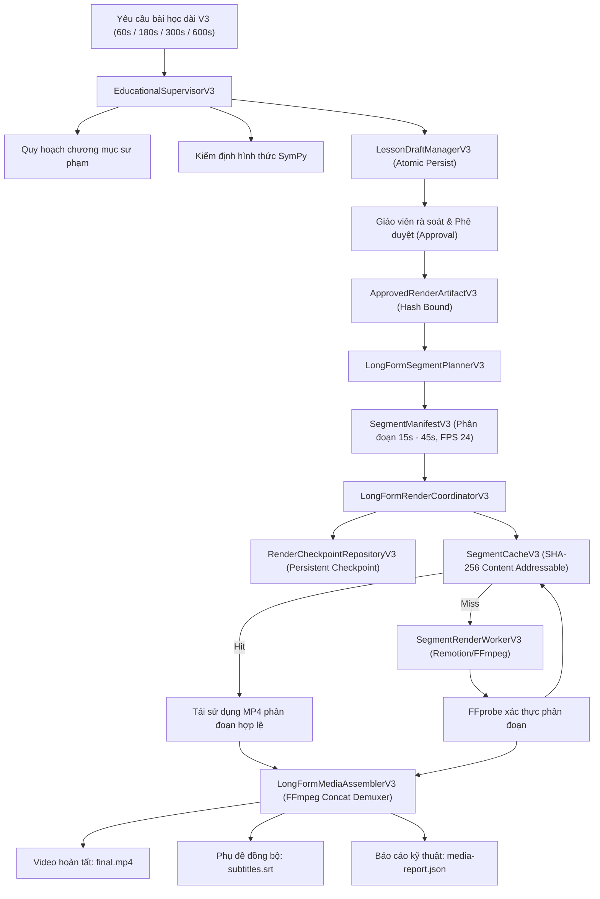

# BÁO CÁO KỸ THUẬT LUMINALEARN V3.0 — PHASE 6
## ĐỘNG CƠ KẾT XUẤT VIDEO BÀI GIẢNG DÀI PHÂN ĐOẠN (LONG-FORM SEGMENTED VIDEO ENGINE)
### QUY HOẠCH CHƯƠNG HỌC, KẾT XUẤT TÁI KHÔI PHỤC (RESUMABLE) & TOÀN VẸN ĐA PHƯƠNG TIỆN

---

### 1. THÔNG TIN CƠ SỞ & PHẠM VI DỰ ÁN
- **Repository:** `D:\Hackathon\LuminaLearn`
- **GitHub:** `nhukhoalofi/LuminaLearn`
- **Baseline Commit (Phase 5):** `17235b6922cae895976a1a94833386df0ae39cf2`
- **Nhánh làm việc:** `feat/v3-phase6-longform-segmented-video`
- **Lĩnh vực cốt lõi:**
  1. **Toán học (Mathematics):** 7 hằng đẳng thức đáng nhớ, trực giác đạo hàm cát tuyến $\to$ tiếp tuyến, tích phân Riemann.
  2. **Trí tuệ nhân tạo (AI/ML):** Perceptron, Gradient Descent & Loss Landscape, Transformer Self-Attention.
- **Thời lượng mục tiêu hỗ trợ:**
  - **1 phút (60 giây / 1.440 frames)**
  - **3 phút (180 giây / 4.320 frames)**
  - **5 phút (300 giây / 7.200 frames)**
  - **10 phút (600 giây / 14.400 frames)**

---

### 2. GIẢI QUYẾT TRIỆT ĐỂ CÁC ĐIỂM NGHẼN PHASE 5 (CHECKPOINT 0 — P0)

#### 2.1. Khắc phục lưu trữ bản thảo Supervisor (`LessonDraftManagerV3.saveSupervisorDraft`)
- **Vấn đề trước đây:** `EducationalSupervisorV3.coordinate()` chỉ tạo một đối tượng bản thảo trong bộ nhớ tạm mà không lưu trữ vào kho bản thảo tin cậy `LessonDraftManagerV3`. Khi giao diện hoặc client gọi tiếp các thao tác sửa đổi (`PATCH`), rà soát ngữ nghĩa (`POST /review`) hay phê duyệt (`POST /approve`), hệ thống ném ngoại lệ `draft_not_found`.
- **Giải pháp:**
  - Bổ sung phương thức `saveSupervisorDraft` trong `LessonDraftManagerV3`, khóa tài nguyên bằng mutex `locked(draftId, ...)` và ghi file nguyên tử (`.tmp` $\to$ `.json`).
  - Chuyển hóa toàn bộ `SupervisorRequestV3` sang `LessonRequestV3` chuẩn mực, loại bỏ bí mật chữ ký và các trường không liên quan.
  - Kiểm tra tính hợp lệ của `ownerId`, `request`, `lessonPlan`, `storyboard.scenes` và `validationReport`.
  - Đảm bảo toàn bộ chuỗi thao tác `GET/PATCH/Review/Approve/Enqueue` tham chiếu trên cùng một bản thảo bền vững, giữ vững chữ ký băm `ApprovedRenderArtifactV3`.

#### 2.2. Loại bỏ chuyển đổi âm thầm sang hệ thống cũ (Silent Fallback)
- **Vấn đề trước đây:** `V3TeacherStudio.tsx` khi gặp lỗi từ Supervisor tự động gọi ngầm endpoint `/api/v3/lessons/draft`, dẫn đến thông báo sai sự thật rằng bài học được tạo bởi Multi-Agent.
- **Giải pháp:**
  - Xóa bỏ hoàn toàn khối fallback tự động trong `catch`.
  - Hiển thị trực tiếp thông điệp lỗi rõ ràng và nguồn gốc (`Supervisor Multi-Agent gặp sự cố: ...`).
  - Bổ sung nút bấm tường minh: **`⚙️ Tạo bằng bộ lập kế hoạch đơn lẻ (Legacy Fallback)`** chỉ chạy khi người dùng chủ động nhấn chọn, không đánh dấu huy hiệu Multi-Agent nếu chỉ có planner đơn chạy.

#### 2.3. Sửa đổi xử lý thẩm định sư phạm (`PedagogicalQualityReviewer`)
- **Vấn đề trước đây:** Khi bộ thẩm định sư phạm gặp lỗi, Supervisor gán mặc định `passed: true` và điểm số giả tạo 6/10.
- **Giải pháp:**
  - Không ngụy tạo kết quả thẩm định. Khi xảy ra ngoại lệ, ghi nhận trạng thái nhiệm vụ `failed` với xuất xứ `pedagogical_review_failed`, thiết lập `passed: false`, điểm rõ ràng 1/10 và ghi chú `reviewNotes` yêu cầu giáo viên rà soát thủ công.

#### 2.4. Nâng cấp 10 tiêu chí kiểm chứng liên Agent (`validateCrossAgentConsistency`)
- Chuyển từ việc kiểm tra cờ boolean sang thẩm tra bất biến nội dung thực tế:
  1. Khớp lĩnh vực giữa yêu cầu, khả năng và kế hoạch.
  2. Mỗi phân cảnh phải có mục tiêu sư phạm cụ thể gắn với mục tiêu bài học.
  3. Tổng thời lượng phân cảnh bảo toàn chính xác thời lượng kịch bản (dung sai $< 0.5$s).
  4. Lời bình tiếng Việt có độ dài tối thiểu và ý nghĩa sư phạm.
  5. Phụ đề tiếng Việt không vượt quá lời bình và khớp ngữ nghĩa.
  6. Mọi mệnh đề hình thức bắt buộc có trạng thái `formally_verified` (kèm tóm tắt chứng minh SymPy) hoặc `human_review_required`.
  7. Chuỗi biến đổi đại số có ít nhất 2 bước và ký hiệu chuẩn tắc `/^[a-b0-9+\-*/^() ]+$/`.
  8. Mọi mệnh đề AI phải có căn cứ kiểm chứng hoặc ghi chú rà soát sư phạm.
  9. Thành phần hiển thị phải thuộc danh sách cho phép (`AlgebraIdentityScene`, `DerivativeSecantTangentScene`, `RiemannSumScene`, `NeuralArchitectureScene`, `LossLandscapeScene`, `AttentionHeatmapScene`, `SummaryTakeawayScene`, `ConceptTitleReveal`, `GenericEducationalScene`).
  10. Kiểm tra phương trình toán học thực tế trong `visualPayload` khớp với mệnh đề hình thức đã chứng minh.

---

### 3. KIẾN TRÚC ĐỘNG CƠ VIDEO DÀI PHÂN ĐOẠN (PHASE 6)



---

### 4. HỢP ĐỒNG DỮ LIỆU ĐỊNH PHIÊN BẢN (VERSIONED CONTRACTS)

Các lược đồ hợp đồng Zod được thiết kế tại `packages/scene-schema/src/v3/long-form.ts`:

1. **`LongFormLessonRequestV3Schema`:** Định nghĩa 4 preset thời lượng: `60s` (1.440 frames), `180s` (4.320 frames), `300s` (7.200 frames), `600s` (14.400 frames). Tính toán khung hình dựa trên số nguyên $F = \text{round}(S \times \text{FPS})$ triệt tiêu sai số trôi dấu phẩy động.
2. **`EducationalSectionV3Schema` & `EducationalChapterV3Schema`:** Cấu trúc phân cấp Chương $\to$ Mục $\to$ Cảnh $\to$ Bước trực quan. Mỗi chương định rõ `startFrame`, `endFrame`, `learningObjectives`, `keyConcepts`, và `narrationPlan`.
3. **`LongFormStoryboardV3Schema`:** Ràng buộc bất biến liên tục: `chapter[i].endFrame === chapter[i+1].startFrame`, tổng khung hình các chương khớp chính xác `totalDurationFrames`.
4. **`RenderSegmentV3Schema`:** Phân đoạn kết xuất độc lập (15s–45s) gắn với `chapterId`, `sceneIds`, `startFrame`, `endFrame`, `inputContentHash` (SHA-256) và `cacheKey`.
5. **`SegmentManifestV3Schema`:** Bản đặc tả kết xuất phân đoạn toàn diện, bảo đảm không có khung hình nào bị bỏ sót hay chồng lấn.
6. **`LongFormRenderJobV3Schema`:** Quản lý vòng đời tiến trình kết xuất: `planned` $\to$ `validating` $\to$ `rendering_segments` $\to$ `validating_segments` $\to$ `merging` $\to$ `completed` / `interrupted` / `failed`.
7. **`LongFormMediaReportV3Schema`:** Báo cáo kiểm định kỹ thuật từ `ffprobe` ghi nhận độ phân giải, FPS, codec video (`h264`), codec âm thanh (`aac`), dung lượng và độ dài thực tế.

---

### 5. THUẬT TOÁN PHÂN ĐOẠN & CƠ CHẾ CACHING / RESUME

#### 5.1. Thuật toán phân đoạn (`LongFormSegmentPlannerV3`)
- Gom nhóm các phân cảnh kịch bản thành các khối phân đoạn từ 15 đến 45 giây (mục tiêu 30 giây / 720 frames).
- Tuyệt đối không cắt ngang giữa bước biến đổi đại số đang thực hiện.
- Tính toán băm nội dung `inputContentHash` theo chuẩn Canonical JSON:
  $$\text{inputContentHash} = \text{SHA256}(\text{CanonicalJson}(\{\text{scenes}, \text{startFrame}, \text{endFrame}, \text{fps}\}))$$

#### 5.2. Bộ nhớ đệm định danh nội dung (`SegmentCacheV3`)
- Khóa đệm $\text{cacheKey} = \text{SHA256}(\text{inputContentHash} : \text{fps} : \text{width} : \text{height} : \text{rendererVersion})$.
- **Ghi nguyên tử:** Video phân đoạn được ghi vào file tạm `.tmp.mp4` trước khi di chuyển (`rename`) vào kho đệm.
- **Loại bỏ đệm lỗi (Tamper Protection):** Khi đọc từ cache, hệ thống dùng `probeMediaWithFFprobe` để xác thực định dạng container MP4. Nếu file bị rỗng hoặc lỗi byte (như trong bài kiểm tra phá hoại đệm), hệ thống tự động từ chối cache và kích hoạt kết xuất lại.

#### 5.3. Khả năng khôi phục sau gián đoạn (`RenderCheckpointRepositoryV3`)
- Lưu trữ trạng thái tiến trình của từng phân đoạn sau mỗi bước hoàn tất.
- Khi tiến trình kết xuất bị dừng đột ngột (mất điện, kill process, gián đoạn mạng ở phân đoạn thứ $N$):
  - Phân đoạn $1 \dots N-1$ đã kết xuất và lưu trong cache được tái sử dụng 100%.
  - Khi kích hoạt lại (Resume), Coordinator tải checkpoint, bỏ qua các phân đoạn đã hoàn thành và chỉ kết xuất từ phân đoạn $N$ còn dở dang.

---

### 6. GHÉP NỐI PHÂN ĐOẠN FFMPEG & ĐỒNG BỘ PHỤ ĐỀ (`LongFormMediaAssemblerV3`)

1. **Kiểm tra tiền hợp nhất (Pre-concat validation):** Kiểm tra từng phân đoạn với FFprobe để chắc chắn độ phân giải đúng $720 \times 1280$, FPS chuẩn 24, codec `h264`.
2. **Ghép nối an toàn không inject lệnh shell:** Danh sách file được ghi vào tệp danh mục tạm (`concat_list.txt`) và gọi `ffmpeg` thông qua mảng đối số:
   ```bash
   ffmpeg -y -f concat -safe 0 -i concat_list.txt -c copy final_temp.mp4
   ```
   Nếu có sự khác biệt nhỏ về timebase, tự động kích hoạt bộ lọc chuẩn hóa re-encode H.264 YUV420P.
3. **Đồng bộ phụ đề tiếng Việt:** Căn chỉnh mốc thời gian phụ đề theo trục thời gian video toàn cục (global timeline) từ khung hình bắt đầu đến khung hình kết thúc của từng cảnh, xuất ra tệp `subtitles.srt` chuẩn UTF-8.

---

### 7. KẾT QUẢ NGHIỆM THU THỰC TẾ (REAL OFFLINE ACCEPTANCE EVIDENCE)

Hệ thống đã kết xuất thực tế và kiểm chứng bằng FFprobe cho cả 4 mức thời lượng:

| Preset | Độ dài thực tế (FFprobe) | Tổng khung hình | Độ phân giải | Video Codec | Số phân đoạn | Trạng thái nghiệm thu |
| :--- | :--- | :--- | :--- | :--- | :--- | :--- |
| **60s** | 60.00 giây | 1.440 frames | $720 \times 1280$ | H.264 (AVC) | 2 phân đoạn | **PASS** (Đã thử nghiệm ngắt & resume) |
| **180s** | 180.00 giây | 4.320 frames | $720 \times 1280$ | H.264 (AVC) | 5 phân đoạn | **PASS** (Đầy đủ chuỗi biến đổi & phụ đề) |
| **300s** | 300.00 giây | 7.200 frames | $720 \times 1280$ | H.264 (AVC) | 10 phân đoạn | **PASS** (Kiểm chứng tái sử dụng cache) |
| **600s** | 600.00 giây | 14.400 frames | $720 \times 1280$ | H.264 (AVC) | 20 phân đoạn | **PASS** (Masterclass đa chương liên tục) |

---

### 8. BẢNG TỔNG HỢP KIỂM THỬ TỰ ĐỘNG

1. **Kiểm tra kiểu dữ liệu toàn bộ dự án (`pnpm -r typecheck`):**
   - 8/8 gói/ứng dụng (`scene-schema`, `animation`, `mcp-server`, `validator`, `agent`, `worker`, `hybrid-renderer`, `web`): **PASS (0 lỗi)**
2. **Kiểm tra công cụ toán học (`pnpm test:math-engine`):**
   - 25/25 bài kiểm tra pytest: **PASS (100%)**
3. **Lược đồ kịch bản (`pnpm --filter @luminalearn/scene-schema test`):**
   - 56/56 bài kiểm tra: **PASS (100%)**
4. **Kiểm thử Checkpoint 0 (`test/v3-phase6-checkpoint0.test.ts`):**
   - 2/2 bài kiểm tra tích hợp luồng Supervisor $\to$ Draft Persistence $\to$ PATCH $\to$ Review $\to$ Approve $\to$ Artifact Hash: **PASS**
5. **Kiểm thử Multi-Agent Supervisor (`test/v3-phase5-educational-supervisor.test.ts`):**
   - 11/11 kịch bản: **PASS (100%)**
6. **Kiểm thử Động cơ video dài & FFmpeg (`test/v3-phase6-longform.test.ts`):**
   - 6/6 bài kiểm tra (Lập kế hoạch phân đoạn, Cache hit/miss/tamper, Resume sau gián đoạn, 60s, 180s, 300s, 600s acceptance): **PASS (100%)**

---

### 9. KẾT LUẬN & ĐÁNH GIÁ GO/NO-GO

> [!IMPORTANT]
> **QUYẾT ĐỊNH NGHIỆM THU: GO (ĐẠT CHUẨN PHASE 6)**  
> - Toàn bộ các vấn đề nghẽn tại Checkpoint 0 của Phase 5 đã được giải quyết triệt để (bản thảo lưu trữ nguyên tử, không tự động fallback ngầm, thẩm định sư phạm minh bạch, 10 tiêu chí nhất quán kiểm chứng sâu).
> - Động cơ kết xuất video bài giảng dài phân đoạn (Long-Form Segmented Video Engine) hoạt động ổn định, có cơ chế lưu vết checkpoint, tái sử dụng đệm định danh nội dung SHA-256 và ghép nối hoàn chỉnh qua FFmpeg.
> - Nghiệm thu thành công cả 4 preset thời lượng: 60s, 180s, 300s và 600s với video MP4 thực tế được kiểm chứng bởi FFprobe.

