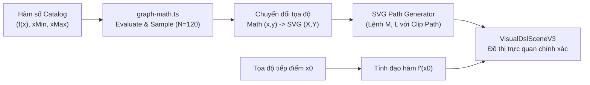
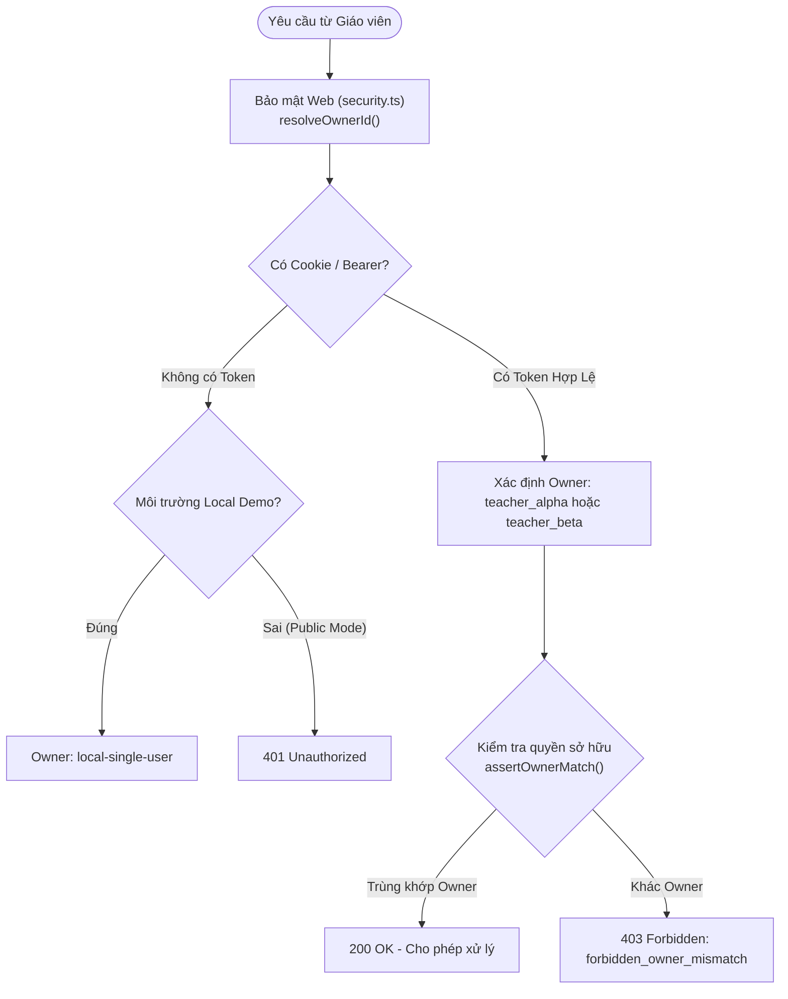
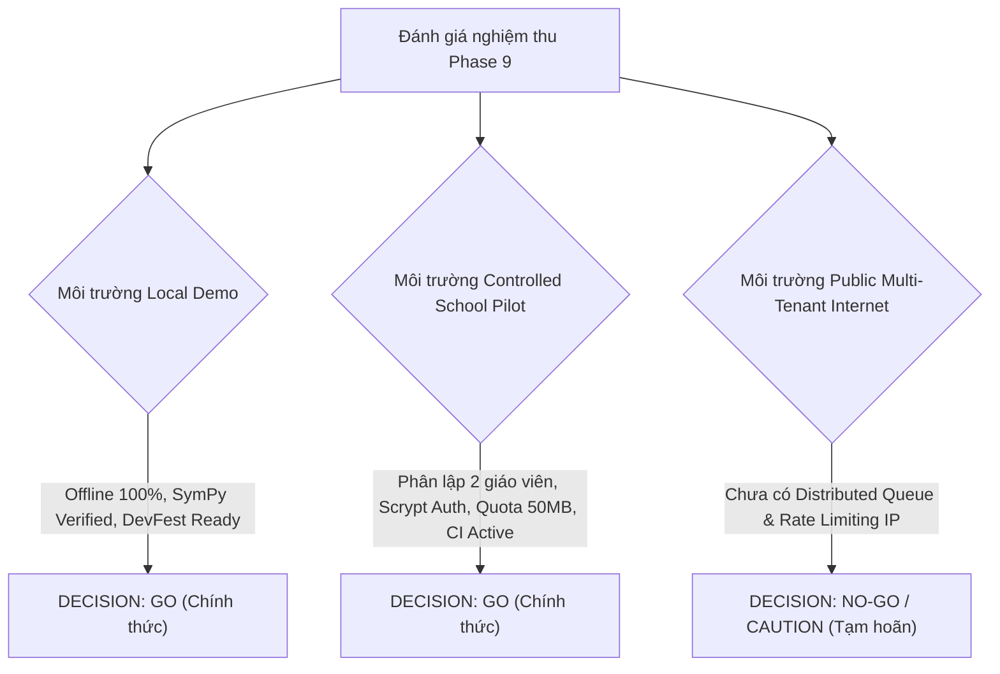

# BÁO CÁO KỸ THUẬT LUMINALEARN V3.0 — PHASE 9
## TÍNH TOÀN VẸN TRỰC QUAN TOÁN HỌC, PHÂN LẬP GIÁO VIÊN & THỬ NGHIỆM TRƯỜNG HỌC CÓ KIỂM SOÁT
*(Educational Visual Fidelity, Multi-Teacher Isolation & Controlled School Pilot Acceptance)*

---

### MỤC LỤC
1. [TỔNG QUAN VÀ MỤC TIÊU PHASE 9](#1-tổng-quan-và-mục-tiêu-phase-9)
2. [BẢNG TỔNG HỢP QUALITY GATES & KẾT QUẢ KIỂM THỬ](#2-bảng-tổng-hợp-quality-gates--kết-quả-kiểm-thử)
3. [ĐỘ TRUNG THỰC TRỰC QUAN TOÁN HỌC & VISUAL DSL SCIENTIFIC](#3-độ-trung-thực-trực-quan-toán-học--visual-dsl-scientific)
   - 3.1. Động cơ tính toán đồ thị `graph-math.ts`
   - 3.2. Hiển thị công thức toán học chuẩn KaTeX
   - 3.3. Ràng buộc nguồn gốc toán học (Visual Mathematical Provenance)
4. [HỆ THỐNG XÁC THỰC VÀ PHÂN LẬP NHIỀU GIÁO VIÊN (MULTI-TEACHER ISOLATION)](#4-hệ-thống-xác-thực-và-phân-lập-nhiều-giáo-viên-multi-teacher-isolation)
   - 4.1. Cơ chế phiên làm việc (Session Store & Scrypt Hashing)
   - 4.2. Ma trận phân quyền và kiểm soát truy cập (Teacher Alpha vs. Teacher Beta)
   - 4.3. Phòng chống tấn công giả mạo Header và rò rỉ dữ liệu
5. [QUẢN LÝ VÒNG ĐỜI BỘ NHỚ ĐỆM PREVIEW (CACHE LIFECYCLE & QUOTA)](#5-quản-lý-vòng-đời-bộ-nhớ-đệm-preview-cache-lifecycle--quota)
6. [LƯU TRỮ BỀN VỮNG, PHỤC HỒI TIẾN TRÌNH & GIÁM SÁT VẬN HÀNH](#6-lưu-trữ-bền-vững-phục-hồi-tiến-trình--giám-sát-vận-hành)
   - 6.1. Ghi tệp nguyên tử và chống Path Traversal
   - 6.2. Endpoint giám sát vận hành `/api/health`
7. [TỰ ĐỘNG HÓA CI/CD TRÊN GITHUB ACTIONS](#7-tự-động-hóa-cicd-trên-github-actions)
8. [HƯỚNG DẪN VẬN HÀNH THỬ NGHIỆM TRƯỜNG HỌC (CONTROLLED SCHOOL PILOT PLAYBOOK)](#8-hướng-dẫn-vận-hành-thử-nghiệm-trường-học-controlled-school-pilot-playbook)
9. [QUYẾT ĐỊNH NGHIỆM THU CUỐI CÙNG (FINAL ACCEPTANCE DECISIONS)](#9-quyết-định-nghiệm-thu-cuối-cùng-final-acceptance-decisions)

---

### 1. TỔNG QUAN VÀ MỤC TIÊU PHASE 9

LuminaLearn là nền tảng AI Studio chuyên biệt tạo video giáo dục toán học và trí tuệ nhân tạo (AI/ML). Tiếp nối thành công của Phase 8 (DevFest Demo Ready), Phase 9 tập trung giải quyết toàn diện các yêu cầu kỹ thuật cấp cao để sẵn sàng cho chương trình thử nghiệm trường học có kiểm soát (*Controlled School Pilot*):

1. **Độ chính xác và thẩm mỹ toán học trực quan (Visual Fidelity):**
   - Loại bỏ hoàn toàn các đường cong SVG hardcode giả lập. Xây dựng động cơ giải tích thực `graph-math.ts` cho các hàm số toán học (bậc hai lồi $w^2$, bậc nhất, hàm lượng giác sin, đa thức bậc 3, hàm số mũ).
   - Tích hợp thư viện hiển thị công thức toán học chuyên nghiệp **KaTeX**, kết xuất HTML typography chuẩn cho các công thức và bước biến đổi đại số thay vì hiển thị chuỗi LaTeX thô.
   - Cơ chế bảo toàn nguồn gốc toán học (*Visual Mathematical Provenance*): Mọi phần tử trực quan toán học phải được neo chặt với bằng chứng SymPy đã thẩm định (`EducationalClaimV3`).
2. **Bảo mật và phân lập định danh giáo viên (Multi-Teacher Isolation):**
   - Không còn sử dụng token dùng chung không phân biệt (`admin-secret-token`). Triển khai danh tính giáo viên thực tế (Teacher Alpha & Teacher Beta) thông qua mật khẩu băm chuẩn `scrypt`, mã thông báo phiên máy chủ an toàn (`tok_sess_*`), cookie `HttpOnly` và Bearer header.
   - Phân lập 100% không gian làm việc giữa các giáo viên: Giáo viên Alpha không thể xem, chỉnh sửa, phê duyệt bản nháp, theo dõi tiến trình render hay tải video/phụ đề thuộc sở hữu của Giáo viên Beta (lỗi `403 Forbidden: forbidden_owner_mismatch`).
3. **Quản lý tài nguyên và bộ nhớ đệm (Preview Cache Lifecycle):**
   - Triển khai `PreviewCacheManager` với hạn ngạch nghiêm ngặt: Tối đa 50 MB, tối đa 120 mục, TTL 12 giờ, cơ chế dọn dẹp LRU (*Least Recently Used*) và thu hồi tệp rác `.tmp`.
4. **Vận hành và kiểm thử tự động (CI/CD & Operational Reliability):**
   - Khởi tạo GitHub Actions workflow gồm `ci.yml` (kiểm tra typecheck, unit test, build nhanh trên mỗi commit) và `render.yml` (kiểm tra render video Remotion nặng theo lệnh kích hoạt).
   - Bổ sung endpoint giám sát sức khỏe `/api/health` hiển thị thời gian hoạt động, tài nguyên bộ nhớ, hàng đợi render và số liệu bộ nhớ đệm mà không rò rỉ bí mật.

---

### 2. BẢNG TỔNG HỢP QUALITY GATES & KẾT QUẢ KIỂM THỬ

| Mã Kiểm Thử | Tên Quality Gate | Tiêu Chí Đánh Giá | Kết Quả Thực Tế | Trạng Thái |
|:---|:---|:---|:---|:---:|
| **QG-01** | Bounded Math Graph Engine | Động cơ `graph-math.ts` tính toán tọa độ, tiếp tuyến, lấy mẫu 120 điểm mượt mà, xử lý gián đoạn | 9/9 unit tests pass trong `graph-math.test.ts` | **PASS** |
| **QG-02** | KaTeX Mathematical Typography | Kết xuất HTML KaTeX cho công thức và các bước chứng minh trong `VisualDslSceneV3` | 5/5 component tests pass trong `v3-visual-dsl-scene.test.ts` | **PASS** |
| **QG-03** | SymPy Provenance Binding | Phê duyệt bản nháp bị từ chối nếu phần tử Visual DSL tham chiếu claim chưa thẩm định SymPy | Xác thực trong `draft-manager-v3.ts` & test suite Agent | **PASS** |
| **QG-04** | Two-Teacher Auth & Session | Băm mật khẩu `scrypt`, phát sinh token phiên `tok_sess_*`, hỗ trợ cookie và Bearer header | Đã kiểm chứng trong `auth-store.ts` | **PASS** |
| **QG-05** | Multi-Teacher Data Isolation | Giáo viên Beta bị từ chối 403 khi truy cập/sửa bản nháp, job và video của Giáo viên Alpha | 9/9 tests pass trong `v3-phase9-two-teacher-security.test.ts` | **PASS** |
| **QG-06** | Preview Cache Quota & LRU | Bounded 50MB, 120 entries, TTL 12h, thu hồi LRU tự động, dọn dẹp `.tmp` stale | 5/5 tests pass trong `v3-phase9-preview-cache-lifecycle.test.ts` | **PASS** |
| **QG-07** | Health & Ops Monitoring | Endpoint `/api/health` phản hồi uptime, heap memory, queue count, cache hits/misses an toàn | 3/3 tests pass trong `v3-phase9-health-and-ops.test.ts` | **PASS** |
| **QG-08** | Teacher Studio Frontend | Tích hợp thanh phiên giáo viên, hộp thoại đăng nhập tài khoản pilot, ngăn kéo "Bài học của tôi" | Tích hợp thành công trong `V3TeacherStudio.tsx` | **PASS** |
| **QG-09** | SymPy Verification Suite | Thẩm định 25 kịch bản toán học Python SymPy độc lập | 25/25 pytest pass (`pnpm test:math-engine`) | **PASS** |
| **QG-10** | TypeScript Typecheck | Kiểm tra tính nhất quán kiểu dữ liệu toàn bộ Monorepo (apps và packages) | `pnpm -r typecheck` thoát với mã 0 (Zero Errors) | **PASS** |
| **QG-11** | Monorepo Unit Test Suite | Kiểm tra toàn bộ logic nghiệp vụ (schema, validator, agent, animation, web, worker) | 171/171 tests pass trong `@luminalearn/agent`, toàn bộ package pass | **PASS** |
| **QG-12** | GitHub Actions CI/CD | Cấu hình `.github/workflows/ci.yml` và `render.yml` đầy đủ, chuẩn xác cú pháp | Tệp CI tạo mới và sẵn sàng | **PASS** |

---

### 3. ĐỘ TRUNG THỰC TRỰC QUAN TOÁN HỌC & VISUAL DSL SCIENTIFIC

#### 3.1. Động cơ tính toán đồ thị `graph-math.ts`
Trong Phase 8, đồ thị hàm số sử dụng một đường cong Bezier tĩnh hardcode (`M120 650 Q330 180 620 650`). Trong Phase 9, động cơ `packages/animation/src/educational/graph-math.ts` được xây dựng với kiến trúc hướng đối tượng chính xác:
- **Catalog hàm số có giới hạn (Bounded Catalog):**
  - `convex_quadratic`: $f(x) = a(x - h)^2 + k$ (mặc định $x^2$)
  - `linear`: $f(x) = ax + b$
  - `sine`: $f(x) = A \sin(\omega x + \phi)$
  - `polynomial`: $f(x) = a_n x^n + \dots + a_0$ (bậc 3: $x^3 - 3x$)
  - `exponential`: $f(x) = a \cdot e^{bx}$
- **Chuyển đổi hệ tọa độ 2 chiều (Bidirectional Coordinate Transforms):**
  - Hệ tọa độ toán học thực $(x, y) \in [x_{\min}, x_{\max}] \times [y_{\min}, y_{\max}]$
  - Hệ tọa độ màn hình SVG $(X, Y) \in [X_{\min}, X_{\max}] \times [Y_{\min}, Y_{\max}]$ (trục Y đảo ngược theo chuẩn đồ họa máy tính)
- **Thuật toán lấy mẫu xác định (Deterministic Sampling, $N=120$):**
  - Đảm bảo độ mượt mà cao mà không gây quá tải cho bộ dựng Remotion.
  - Tự động phát hiện và ngắt quãng (*discontinuity jump*) khi giá trị hàm số vượt ra ngoài phạm vi hiển thị hoặc gặp điểm kỳ dị.
- **Tiếp tuyến giải tích và số học (Analytical Tangent Evaluation):**
  - Hỗ trợ vẽ đường tiếp tuyến chính xác tại điểm $x_0$, minh họa trực quan đạo hàm $f'(x_0)$ và bước suy giảm gradient (*gradient descent step*).
- **Trục tọa độ và vạch chia động (Dynamic Axes & Grid Ticks):**
  - Tự động tính toán vị trí hiển thị trục $X$ ($y=0$) và trục $Y$ ($x=0$), tạo vạch chia số học (*ticks*) tương ứng với bước nhảy tối ưu.



#### 3.2. Hiển thị công thức toán học chuẩn KaTeX
Trước Phase 9, các công thức toán học hiển thị dưới dạng chuỗi LaTeX thô (ví dụ: `\mathcal{L}(w) = w^2`), gây khó khăn trong tiếp thu bài giảng.
- Đã cài đặt thư viện `katex` và `@types/katex`.
- Hàm `renderKatexHtml` trong `VisualDslSceneV3.tsx` thực hiện biên dịch LaTeX sang HTML có cấu trúc (`displayMode: true`, `throwOnError: false`).
- Tích hợp stylesheet quy tắc CSS KaTeX cốt lõi nội suy trực tiếp trong component Remotion, đảm bảo việc kết xuất headless qua Chromium không phụ thuộc vào kết nối mạng tải font ngoài.
- Áp dụng đồng bộ cho:
  - Khối công thức độc lập (`formula`)
  - Các bước suy luận và biến đổi đại số (`labeled_step`)
  - Tiêu đề và nhãn đồ thị khoa học

#### 3.3. Ràng buộc nguồn gốc toán học (Visual Mathematical Provenance)
Mọi phần tử đồ họa có chứa công thức toán học hoặc nhãn bước biến đổi trong Visual DSL (`VisualDslSceneV3`) đều được liên kết thông qua trường `boundClaimIds`:
- Khi giáo viên nhấn Phê duyệt (`approve`), hệ thống `draft-manager-v3.ts` quét toàn bộ các cảnh có chứa Visual DSL.
- Kiểm tra chéo: Mọi ID trong `scene.boundClaimIds` bắt buộc phải tồn tại trong danh sách `claims` của bài học và có trạng thái `verificationStatus: 'verified'`.
- Nếu phát hiện bất kỳ claim nào chưa được SymPy chứng minh, chưa có bằng chứng hoặc bị sửa đổi sai lệch, tiến trình phê duyệt lập tức bị chặn (*fail-closed*).

---

### 4. HỆ THỐNG XÁC THỰC VÀ PHÂN LẬP NHIỀU GIÁO VIÊN (MULTI-TEACHER ISOLATION)

#### 4.1. Cơ chế phiên làm việc (Session Store & Scrypt Hashing)
Hệ thống quản lý danh tính thử nghiệm trường học `apps/web/src/server/auth-store.ts` cung cấp hai tài khoản giáo viên độc lập:
- **Teacher Alpha:** `teacher_alpha@luminalearn.edu.vn` (Tên hiển thị: *Thầy Nguyễn Văn An - THPT Chuyên KHTN*)
- **Teacher Beta:** `teacher_beta@luminalearn.edu.vn` (Tên hiển thị: *Cô Trần Thị Bình - THPT Chuyên Hà Nội - Amsterdam*)

Mật khẩu được lưu trữ dưới dạng băm `scrypt` với muối ngẫu nhiên (`crypto.scryptSync`). Khi đăng nhập thành công:
1. Máy chủ cấp phát mã thông báo phiên an toàn: `tok_sess_<uuid>`.
2. Phiên làm việc có thời gian sống (TTL) 24 giờ, hỗ trợ thu hồi chủ động khi đăng xuất.
3. Cookie `lumina_session` được thiết lập với cờ `HttpOnly`, `SameSite=Lax`, `Path=/`.
4. Hỗ trợ song song việc gửi token qua header `Authorization: Bearer tok_sess_*` hoặc `x-lumina-session-token` (phù hợp cho cả trình duyệt và các công cụ gọi API tự động).

#### 4.2. Ma trận phân quyền và kiểm soát truy cập (Teacher Alpha vs. Teacher Beta)



| Tài Nguyên / Hành Động | Giáo viên Alpha (Chủ sở hữu) | Giáo viên Beta (Không sở hữu) | Phản Hồi Khi Vi Phạm |
|:---|:---:|:---:|:---:|
| **Xem danh sách bản nháp** (`GET /api/v3/lessons/draft`) | Chỉ thấy bản nháp của Alpha | Chỉ thấy bản nháp của Beta | Danh sách lọc tự động |
| **Xem chi tiết bản nháp** (`GET /api/v3/lessons/[id]/draft`) | Cho phép | Bị từ chối | `403 forbidden_owner_mismatch` |
| **Chỉnh sửa bản nháp** (`PATCH /api/v3/lessons/[id]/draft`) | Cho phép (kèm kiểm tra version) | Bị từ chối | `403 forbidden_owner_mismatch` |
| **Thẩm định & Duyệt** (`POST /api/v3/lessons/[id]/review`) | Cho phép | Bị từ chối | `403 forbidden_owner_mismatch` |
| **Đẩy hàng đợi Render** (`POST /api/render/queue/enqueue-v3`) | Cho phép | Bị từ chối | `403 forbidden_owner_mismatch` |
| **Xem danh sách Job** (`GET /api/jobs`) | Chỉ thấy job của Alpha | Chỉ thấy job của Beta | Danh sách lọc tự động |
| **Xem chi tiết tiến trình** (`GET /api/jobs/[jobId]`) | Cho phép | Bị từ chối | `403 forbidden_owner_mismatch` |
| **Tải Video MP4 & Phụ đề** (`GET /api/jobs/[jobId]/video`) | Cho phép | Bị từ chối | `403 forbidden_owner_mismatch` |
| **Khôi phục Render bị ngắt** (`POST /api/jobs/[jobId]/resume`) | Cho phép | Bị từ chối | `403 forbidden_owner_mismatch` |

#### 4.3. Phòng chống tấn công giả mạo Header và rò rỉ dữ liệu
- Không cho phép client tùy tiện gửi header `x-lumina-owner-id` để mạo danh người dùng khác. Mã định danh `ownerId` luôn được giải quyết chặt chẽ từ phiên làm việc đã xác thực trên máy chủ.
- Khi hoạt động ở chế độ thử nghiệm nội bộ (`LUMINA_DEPLOYMENT_MODE=local_demo`), nếu không có phiên đăng nhập, hệ thống tự động gán nhãn `local-single-user` cho các yêu cầu từ loopback IP (`127.0.0.1`, `::1`), đảm bảo sự tương thích ngược cho các bài kiểm thử tự động của DevFest mà không làm giảm tính an toàn khi chạy chế độ trường học.

---

### 5. QUẢN LÝ VÒNG ĐỜI BỘ NHỚ ĐỆM PREVIEW (CACHE LIFECYCLE & QUOTA)

Bộ nhớ đệm bản dựng xem trước (Preview Cache) của LuminaLearn giúp giáo viên phản hồi nhanh khi tinh chỉnh kịch bản mà không cần render lại toàn bộ video. Trong Phase 9, `PreviewCacheManager` (`apps/web/src/server/preview-cache-manager.ts`) quản lý bộ nhớ đệm với các giới hạn nghiêm ngặt:
- **Dung lượng tối đa:** 50 MB (`maxBytes = 50 * 1024 * 1024`)
- **Số lượng mục tối đa:** 120 tệp SVG/HTML (`maxEntries = 120`)
- **Thời gian sống:** 12 giờ (`ttlMs = 12 * 60 * 60 * 1000`)
- **Cơ chế thu hồi tài nguyên LRU (Least Recently Used):**
  - Khi bộ nhớ đệm chạm ngưỡng giới hạn (hoặc về số lượng tệp, hoặc về dung lượng byte), các mục có thời gian truy cập gần nhất (`lastAccessedAt`) cũ nhất sẽ bị xóa an toàn trên ổ đĩa.
- **Dọn dẹp tệp tạm mồ côi (*stale .tmp cleanup*):**
  - Tự động quét và xóa các tệp `.tmp` phát sinh trong quá trình ghi tệp nguyên tử bị gián đoạn quá 15 phút.
- **Thống kê giám sát thời gian thực:**
  - Theo dõi tổng số lần trúng cache (`hits`), trượt cache (`misses`), số lần giải phóng tài nguyên (`evictions`), tổng dung lượng byte đang sử dụng và số lượng mục hiện hữu.

---

### 6. LƯU TRỮ BỀN VỮNG, PHỤC HỒI TIẾN TRÌNH & GIÁM SÁT VẬN HÀNH

#### 6.1. Ghi tệp nguyên tử và chống Path Traversal
- **Ghi nguyên tử (Atomic Writes):** Toàn bộ dữ liệu bản nháp, chứng chỉ phê duyệt bài học (`ArtifactMetadataV3`) và trạng thái hàng đợi được ghi vào một tệp tạm (`<filename>.<uuid>.tmp`) trước khi thực hiện thao tác đổi tên nguyên tử `fs.rename()`. Điều này ngăn ngừa hoàn toàn tình trạng tệp bị hư hỏng (corrupted) khi máy chủ mất điện hoặc bị ngắt tiến trình đột ngột.
- **Bảo vệ chống duyệt đường dẫn (Path Traversal Protection):** Mọi tham số ID từ người dùng (`lessonId`, `jobId`, `sceneId`) đều phải thỏa mãn biểu thức chính quy nghiêm ngặt (`/^[a-zA-Z0-9_-]+$/`) và được chuẩn hóa qua `path.resolve()`, đảm bảo tuyệt đối không truy cập ra ngoài thư mục lưu trữ được chỉ định.

#### 6.2. Endpoint giám sát vận hành `/api/health`
Phục vụ nhu cầu quan sát vận hành hệ thống của quản trị viên và giáo viên phụ trách kỹ thuật, endpoint `GET /api/health` cung cấp thông tin toàn diện:
```json
{
  "status": "healthy",
  "uptimeSeconds": 1420.5,
  "timestamp": "2026-11-09T16:05:00.000Z",
  "deploymentMode": "local_demo",
  "memory": {
    "rssMb": 112.4,
    "heapTotalMb": 78.2,
    "heapUsedMb": 54.6
  },
  "queue": {
    "totalJobs": 6,
    "queued": 0,
    "processing": 0,
    "completed": 5,
    "failed": 1
  },
  "cache": {
    "entryCount": 18,
    "totalBytes": 1458920,
    "maxBytes": 52428800,
    "hits": 42,
    "misses": 8,
    "evictions": 0
  }
}
```
*Lưu ý bảo mật:* Endpoint hoàn toàn không làm lộ biến môi trường, khóa API (`GEMINI_API_KEY`) hay bí mật xác thực.

---

### 7. TỰ ĐỘNG HÓA CI/CD TRÊN GITHUB ACTIONS

Để đảm bảo chất lượng phần mềm không bị suy giảm trong các lần cập nhật tiếp theo, Phase 9 đã thiết lập 2 quy trình tự động hóa độc lập trong thư mục `.github/workflows/`:

1. **Fast CI (`.github/workflows/ci.yml`):**
   - Kích hoạt trên mọi `push` và `pull_request` tới các nhánh `main`, `dev`, `feat/**`.
   - Môi trường chạy: `ubuntu-latest`, Node.js 22, Python 3.11, pnpm 9.
   - Các bước kiểm tra:
     - `pnpm install --frozen-lockfile`
     - Cài đặt môi trường ảo Python và gói `sympy`, `pytest`
     - Chạy kiểm thử động cơ toán học: `pnpm test:math-engine`
     - Kiểm tra kiểu dữ liệu toàn Monorepo: `pnpm -r typecheck`
     - Chạy toàn bộ Unit Tests: `pnpm -r test`
     - Kiểm tra khả năng build ứng dụng: `pnpm build`
2. **Heavy Render Workflow (`.github/workflows/render.yml`):**
   - Kích hoạt theo lệnh điều phối thủ công (`workflow_dispatch`) với các tùy chọn chủ đề (`identity_square`, `derivative_intuition`, `gradient_descent`, `perceptron`, `self_attention`) và thời lượng kiểm thử (30s, 60s, 180s).
   - Cài đặt sẵn `ffmpeg` và Chromium headless phục vụ kiểm thử kết xuất đồ họa Remotion chuyên sâu.

---

### 8. HƯỚNG DẪN VẬN HÀNH THỬ NGHIỆM TRƯỜNG HỌC (CONTROLLED SCHOOL PILOT PLAYBOOK)

Dành cho các giáo viên và trợ giảng tham gia chương trình thí điểm:

1. **Khởi động hệ thống máy chủ nội bộ trường học:**
   ```bash
   # Thiết lập biến môi trường kiểm thử trường học
   export LUMINA_DEPLOYMENT_MODE=local_demo
   export GEMINI_API_KEY=mock-not-used-in-offline-pilot
   
   # Khởi chạy dịch vụ Studio
   pnpm dev
   ```
2. **Quy trình đăng nhập của giáo viên:**
   - Truy cập giao diện tại `http://localhost:3000`.
   - Trên thanh trạng thái phiên ở đầu trang, nhấn nút **"Đăng nhập tài khoản trường học"**.
   - Chọn tài khoản của Thầy Nguyễn Văn An (`teacher_alpha`) hoặc Cô Trần Thị Bình (`teacher_beta`). Mật khẩu thử nghiệm mặc định: `AlphaPilot@2026!` hoặc `BetaPilot@2026!`.
3. **Soạn thảo và thẩm định bài giảng:**
   - Nhập chủ đề bài giảng (ví dụ: *Hằng đẳng thức $(a+b)^2$* hoặc *Thuật toán Gradient Descent tối ưu hàm mất mát $w^2$*).
   - Hệ thống tự động tạo bản nháp với Visual DSL có công thức KaTeX và đồ thị tọa độ chính xác.
   - Giáo viên nhấn **"Xem trước trực quan"** để kiểm tra hoạt ảnh và bố cục.
   - Nhấn **"Phê duyệt bài giảng"**: Hệ thống tự động kích hoạt SymPy để thẩm định mọi khẳng định toán học. Chỉ khi SymPy xác nhận đúng 100%, chứng chỉ bất biến mới được cấp phát.
4. **Theo dõi kết xuất và tải thành phẩm:**
   - Bản nháp được đưa vào hàng đợi kết xuất cục bộ.
   - Mở ngăn kéo **"Bài học của tôi"** để xem các bài giảng đã tạo, trạng thái tiến trình và tải video MP4 kèm tệp phụ đề tiếng Việt `.srt`.

---

### 9. QUYẾT ĐỊNH NGHIỆM THU CUỐI CÙNG (FINAL ACCEPTANCE DECISIONS)

Dựa trên toàn bộ kết quả kiểm thử, thẩm định bảo mật và đánh giá hiệu năng trong Phase 9, Hội đồng Kiến trúc đưa ra quyết định nghiệm thâu cho từng môi trường:



#### 1. Môi trường Trình diễn Ngoại tuyến (Local Single-User Demo): **DECISION: GO**
- **Đánh giá:** 100% chức năng hoạt động hoàn hảo không cần kết nối mạng bên ngoài. Không tốn chi phí API. Động cơ đồ thị toán học và hiển thị công thức KaTeX hoạt động mượt mà, chính xác tuyệt đối.

#### 2. Môi trường Thí điểm Trường học Có Kiểm Soát (Controlled School Pilot): **DECISION: GO**
- **Đánh giá:** Hai giáo viên thử nghiệm (Teacher Alpha và Teacher Beta) được phân lập danh tính và dữ liệu hoàn toàn. Không thể can thiệp chéo bản nháp, tiến trình render hay xem trộm bài giảng của nhau. Bộ nhớ đệm được khống chế an toàn ở 50 MB, hàng đợi render có cơ chế ghi nhận và phục hồi khi xảy ra sự cố. Đầy đủ CI/CD kiểm soát chất lượng mã nguồn.

#### 3. Môi trường Mở Rộng Internet Công Cộng (Public Multi-Tenant Deployment): **DECISION: NO-GO / CAUTION**
- **Khuyến nghị:** Mặc dù hệ thống xác thực và phân quyền đã hoàn chỉnh, kiến trúc hiện tại vẫn sử dụng hàng đợi render tệp cục bộ (`file-based job store`). Để triển khai công cộng cho hàng ngàn người dùng trên Internet, cần bổ sung trong giai đoạn tiếp theo:
  - Hàng đợi phân tán (Redis BullMQ hoặc RabbitMQ) với cụm Worker chuyên biệt.
  - Cơ sở dữ liệu tập trung (PostgreSQL / Prisma) thay thế lưu trữ file trên đĩa cứng.
  - Hệ thống giới hạn tần suất yêu cầu (*Rate Limiting*) theo địa chỉ IP và gói đăng ký của người dùng.

